# viz

A command-line tool that turns audio files into audio-reactive videos for Instagram Reels, feed posts and YouTube.

- **Styles:** `bars`, `radial`, `wave`, `particles`, `occult`, `industrial`, `vines`, `hands`, `ghostship`, `lighthouse`, `kraken`, `abyss`, `aurora`, `maelstrom`, `drowned`, `marsh`, `gallows`, `shadows`, `reactor`, `rhino`, `temple`, `medusa`, `labyrinth`, `hydra`, `pegasus`. Each has its own settings (`-P key=value`).
- **Scenes:** blend between styles at chosen times, or let `--auto` / `--analyze` find the intro, drops and breakdowns.
- **Formats:** 9:16 Reel, 4:5 feed, 1:1 square and 16:9 landscape. Output is H.264 + AAC, ready for Instagram.
- **Music-aware:** `--hook` starts on the drop, a beat grid keeps things on the bar, settings can follow the audio (`-P glow=1+pulse*3`), and `--loop` makes Reels that loop seamlessly.
- **Extras:** palettes, cover art, title text, post-effects (bloom, VHS, shake…), grayscale mode, ASCII-art mode and film grain.
- **Workflow:** `--watch` re-renders as you edit, `--random` finds new looks, and a CSV/JSON file renders a whole campaign.

## Gallery

All rendered from the same track, square format. The first six rows are each style at default settings, then `rhino` and `temple` three ways each, then the Greek myths: `medusa`, `labyrinth`, `hydra` and `pegasus`. The last three show some variations: `shadows` plain, with film grain and in blood red, the lighthouse in a storm, a scene change (vines flashing into occult right on the drop), the hands rotating, and ASCII mode. [More looks](#more-looks) below shows palettes, effects, transitions and music-driven settings.

| 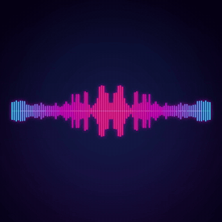 | 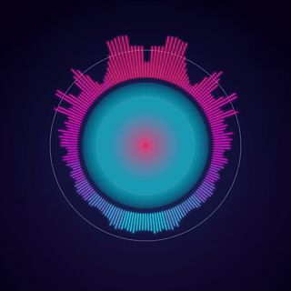 | 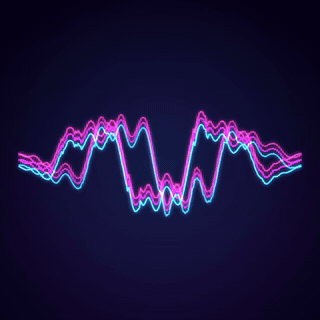 |
|:---:|:---:|:---:|
| `-s bars` | `-s radial` | `-s wave` |
| 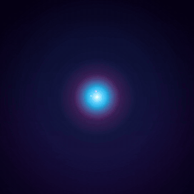 | 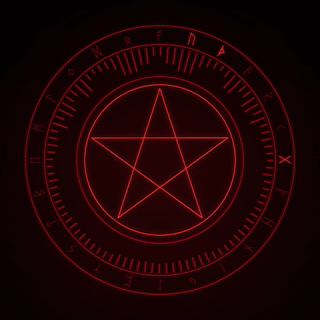 | 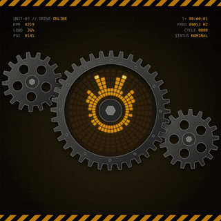 |
| `-s particles` | `-s occult -P symbol=cycle` | `-s industrial` |
| 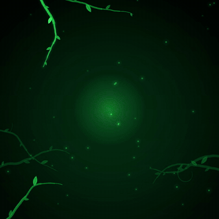 | 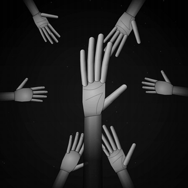 | 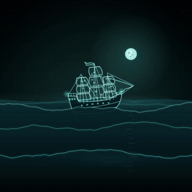 |
| `-s vines` | `-s hands` | `-s ghostship` |
| 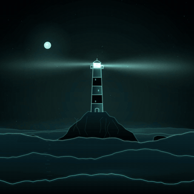 | 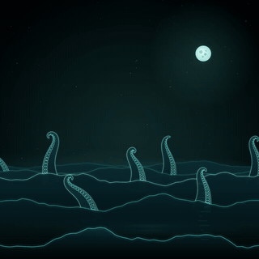 | 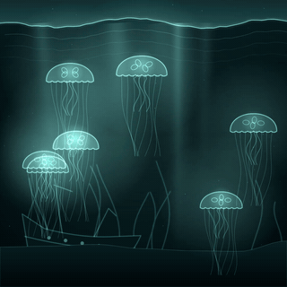 |
| `-s lighthouse` | `-s kraken` | `-s abyss` |
| 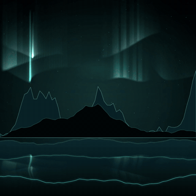 | 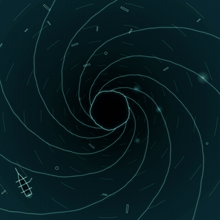 | 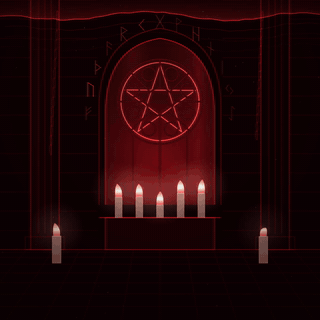 |
| `-s aurora` | `-s maelstrom` | `-s drowned` |
| 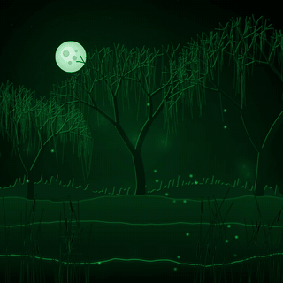 | 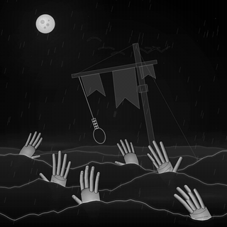 | 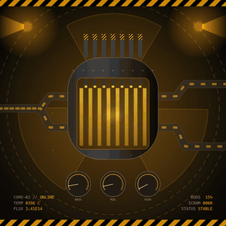 |
| `-s marsh` | `-s gallows` | `-s reactor` |
| 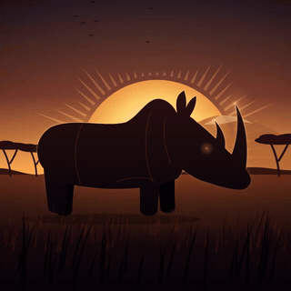 | 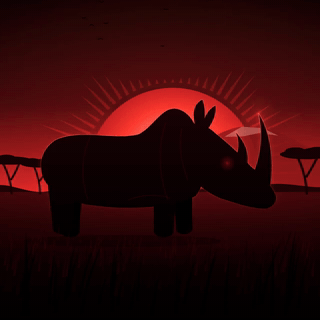 | 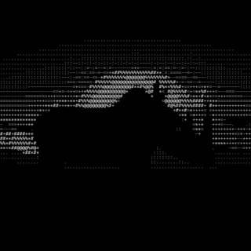 |
| `-s rhino` | `-s rhino -p blood -P charge=2` | `-s rhino --ascii 12` |
| 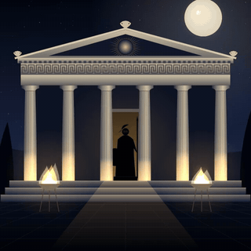 | 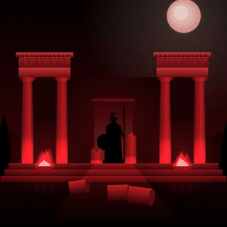 | 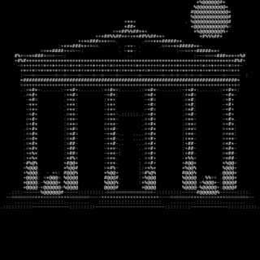 |
| `-s temple` | `-s temple -P ruin=0.7 -p blood` | `-s temple --ascii 12` |
| 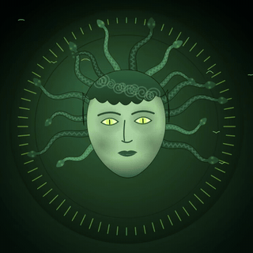 | 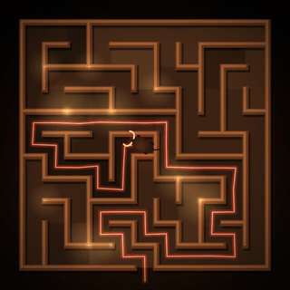 | 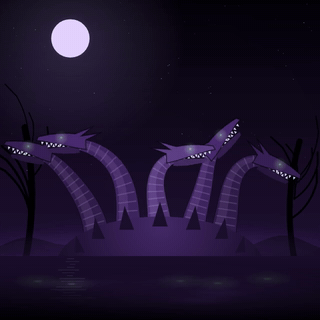 |
| `-s medusa` | `-s labyrinth` | `-s hydra` |
|  | 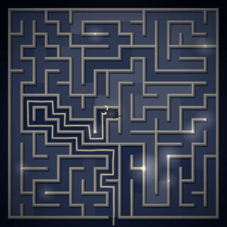 | 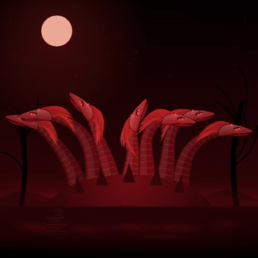 |
| `-s pegasus` | `-s labyrinth -p aegean -P size=0.7` | `-s hydra -p blood -P heads=7` |
| 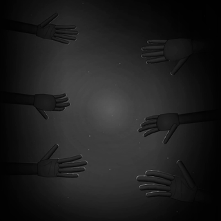 | 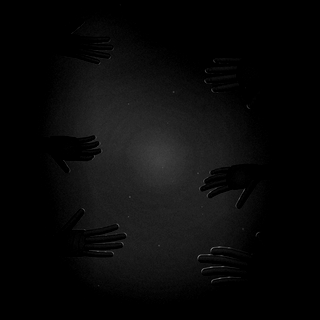 | 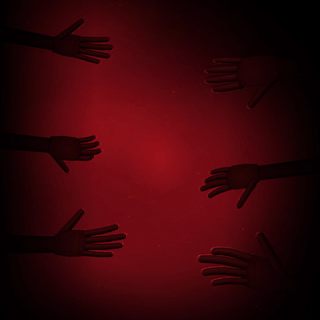 |
| `-s shadows` | `-s shadows -g` | `-s shadows -p blood -P gloom=2` |
| 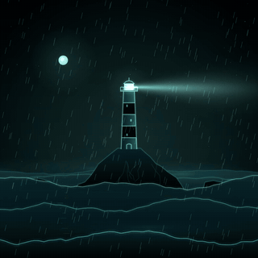 | 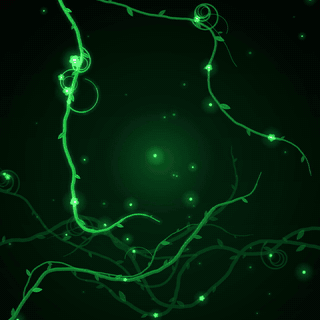 |  |
| `-s lighthouse -P rain=2 -P crash=2 -P beams=1` | `--scene …=occult,transition=flash` | `-s hands -P rotate=0.25` |
| 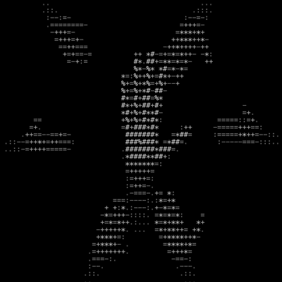 | 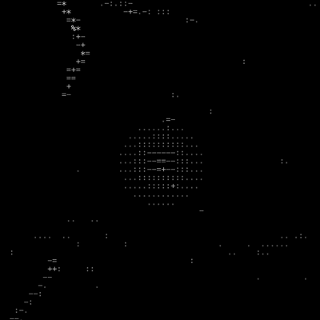 | 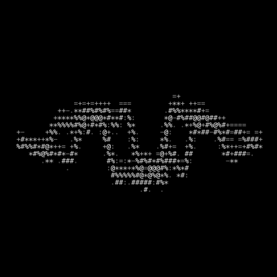 |
| `-s hands --ascii 16` | `-s vines --ascii 16` | `-s wave --ascii 16` |

### More looks

The same styles with other palettes and settings, [post-effects](#post-effects---fx), the new [transitions](#scenes-blending-between-styles) (each switching on the drop) and [settings that follow the music](#audio-driven-settings--p-keyexpression). Same track, the 4 seconds around the drop.

**Palettes and settings**

| 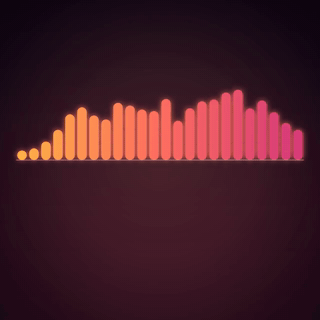 | 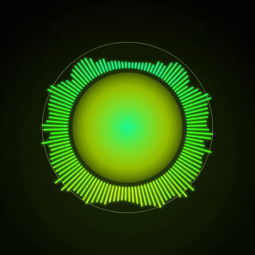 | 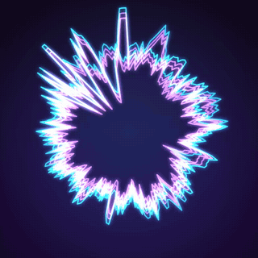 |
|:---:|:---:|:---:|
| `-s bars -p sunset -P bars=24 -P mirror=0 -P reflect=0` | `-s radial -p acid -P bars=60 -P spin=0.25` | `-s wave -p vapor -P shape=circle -P amp=0.4` |
| 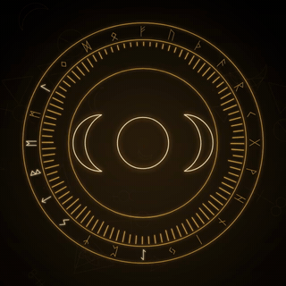 | 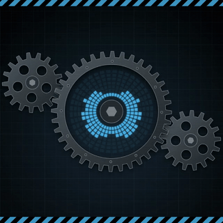 | 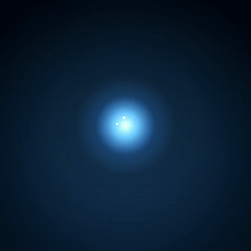 |
| `-s occult -p candle -P symbol=triplemoon` | `-s industrial -p steel -P hud=0 -P sparks=2` | `-s particles -p ice -P burst=200 -P speed=22` |

**Post-effects: `--fx`**

| 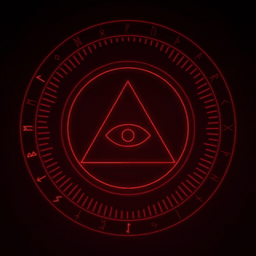 | 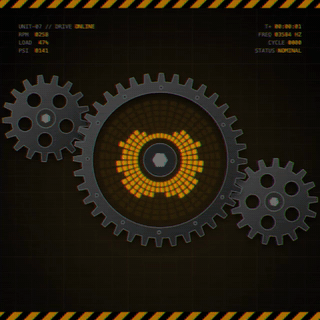 | 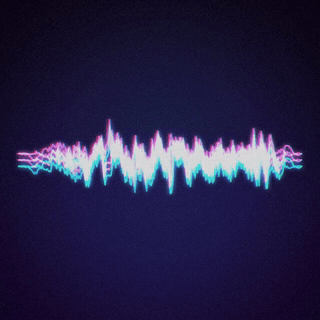 |
|:---:|:---:|:---:|
| `-s occult -P symbol=eye --fx bloom` | `-s industrial --fx vhs,shake` | `-s wave -p vapor --fx vhs,scanlines --grain 8` |
| 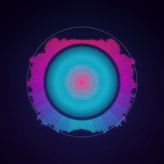 | 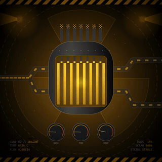 | 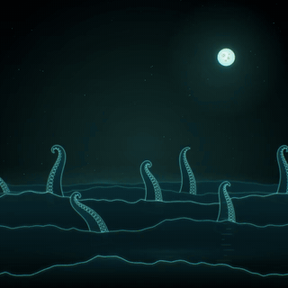 |
| `-s radial --fx chroma=2,bloom=0.6` | `-s reactor --fx shake=2,vignette` | `-s kraken --fx bloom,chroma` |

**Transitions: `--scene …,transition=`**

| 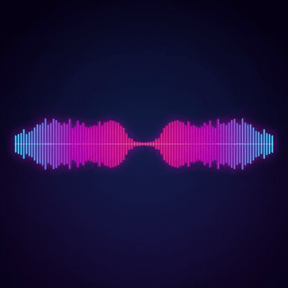 |  |  |  |
|:---:|:---:|:---:|:---:|
| `bars → occult, transition=wipe` | `vines → reactor, transition=zoom` | `wave → industrial, transition=glitch` | `abyss → kraken, transition=kick` |

**Settings that follow the music: `-P key=expression`**

|  |  |  |  |
|:---:|:---:|:---:|:---:|
| `-s radial -P glow=1+pulse*3 -P spin=bass*0.3` | `-s occult -P symbol=cycle -P on=beat -P cycle=2` | `-s aurora -P height=0.7+bar*0.6` | `-s hands -g -P rotate=bass*0.5 --fx bloom=0.5` |

## Contents

- [Gallery](#gallery)
- [Installation](#installation)
- [Usage](#usage)
- [Ready-made commands](#ready-made-commands)
- [Every option](#every-option)
- [Styles and their --param settings](#styles-and-their---param-settings)
- [ASCII mode: --ascii](#ascii-mode---ascii)
- [Scenes: blending between styles](#scenes-blending-between-styles)
- [Automatic sections: --analyze / --auto](#automatic-sections---analyze----auto)
- [Hook, beat grid and drum stems](#hook-beat-grid-and-drum-stems)
- [Audio-driven settings: -P key=expression](#audio-driven-settings--p-keyexpression) (incl. LFOs and automation)
- [Post-effects: --fx](#post-effects---fx)
- [Seamless loops: --loop](#seamless-loops---loop)
- [Workflow: --watch, --random and batch files](#workflow---watch---random-and-batch-files)
- [Recipes](#recipes)
- [Instagram tips](#instagram-tips)
- [Adding your own style](#adding-your-own-style)
- [Project layout](#project-layout)
- [Troubleshooting](#troubleshooting)

## Installation

### 1. Requirements

| | |
|---|---|
| **Node.js 20 or newer** | Check with `node --version`. Install with [nvm](https://github.com/nvm-sh/nvm) (`nvm install --lts`) or `brew install node` |
| **ffmpeg** | Decodes the audio and encodes the video. `brew install ffmpeg` (Linux: `sudo apt install ffmpeg`) |
| **git** | To download the code. Comes with the Xcode command line tools on macOS |

Made and tested on macOS. Linux and Windows should work as long as `ffmpeg` is on your `PATH`, but `--open` only works on macOS.

### 2. Download and install

```bash
git clone https://github.com/RhinoBetatron/viz.git
cd viz
npm install      # installs the three dependencies (commander, fft.js, skia-canvas)
npm link         # makes the `viz` command available in every folder
```

The repo is private, so cloning asks you to log in to GitHub. If you have the GitHub CLI, `gh repo clone RhinoBetatron/viz` works too.

### 3. Check it works

```bash
viz --version        # → 0.1.0
viz --list-styles    # every style and its settings
```

### Updating

```bash
cd viz
git pull
npm install          # only needed if dependencies changed
```

Because `npm link` points at this folder, any changes (yours or pulled) take effect right away. You don't need to reinstall.

### Uninstalling

```bash
npm unlink -g viz    # removes the global command
```

Then delete the folder.

### Install gotchas

- **Moved the folder?** Run `npm link` again from the new location.
- **Using nvm?** The link only exists for the Node version that was active when you ran `npm link`. If `viz` says `command not found` after switching Node versions, run `npm install && npm link` in the folder again.
- **No global install wanted?** Run it in place with `node bin/viz.js track.wav …`.

---

## Usage

```
viz <audio file or folder> [options]
```

Give it a `.wav`, `.aiff`, `.flac`, `.mp3` or `.m4a` file. You get an MP4 next to it, named `<track>_<style>.mp4`. By default that's a 15-second, 9:16 Reel from the start of the track.

```bash
viz track.wav                         # 15s "bars" Reel from the start of the track
viz track.wav -s vines --open         # another style, and open the video when done
viz track.wav -s radial -c cover.jpg  # circular spectrum around your cover art
```

### A typical workflow

1. **Pick the moment.** Choose where the teaser starts and how long it runs. Starting just before the drop works well for Instagram, and `--hook` finds that spot for you:
   ```bash
   viz track.wav --start 1:05 -d 20
   viz track.wav --hook -d 20          # or: 2s before the biggest drop
   ```
2. **Pick a look.** Choose a style (`-s`), a palette (`-p`) and optionally cover art (`-c`) and text (`-t`, `--subtitle`). Run `viz --list-styles` and `viz --list-palettes` to see what's available.
3. **Preview fast.** Add `--preview` to render a quick half-resolution draft. Without scene changes it's capped at 5s.
   ```bash
   viz track.wav --start 1:05 -d 20 -s occult -p candle --preview --open
   ```
4. **Tweak the style.** Pass settings with `-P key=value`, repeating it for more than one:
   ```bash
   viz track.wav -s occult -P symbol=eye -P spin=0.06 --preview --open
   ```
5. **Render the real thing.** Drop `--preview`. Use `-f feed` (4:5) or `-f square` for feed posts, and `-f landscape` for YouTube.
6. **Upload.** AirDrop the MP4 to your phone and post it.

### Switching styles during a video

- **By hand:** `--scene <time>=<style>` changes the style at a point in the track:
  ```bash
  viz track.wav --start 0:45 -d 30 -s wave --scene 1:05=industrial,transition=flash
  ```
- **Automatically:** `--analyze` finds the intro, drops and breakdowns and prints a command for them. `--auto` renders the whole track with styles switching on their own:
  ```bash
  viz track.wav --analyze
  viz track.wav --auto vines,occult --open
  ```

### Many tracks at once

Give it a folder instead of a file to render every audio file in it with the same settings:

```bash
viz ./teasers -s radial -p sunset -d 15
```

Or give each track its own start, style and title in a `.csv` / `.json` file: `viz campaign.csv` (see [batch files](#batch-files-a-whole-release-campaign)).

Everything below is the full reference: ready-made commands, every option and every style setting.

---

## Ready-made commands

Copy, replace `TRACK.wav` (and `COVER.jpg` where used) and run. All of them make a Reel and open it when done.

- **Change where the clip starts:** add or change `--start 1:12` (default is the beginning of the track).
- **Change the length:** `-d 20`.
- **Scene times written as `+12`** are seconds into the clip, so they move with `--start`. Put the `--start` about 10–15s before the drop, and the switch lands on it.
- **Try it fast first:** add `--preview` to any command.
- **Other formats:** add `-f feed` (4:5) or `-f square` to any command.

### Single style

```bash
# Clean & simple: neon spectrum bars, 15s
viz TRACK.wav -s bars --open

# Release teaser: cover art in the middle, colours pulled from the artwork
viz TRACK.wav -s radial -c COVER.jpg -p auto -t "NEW SINGLE" --subtitle "OUT NOW" -d 20 --open

# Dark & minimal: single grainy black & white waveform
viz TRACK.wav -g -s wave -P lines=1 -P trail=0.7 --grain 14 -d 20 --open

# Ember storm: particles exploding on every hit
viz TRACK.wav -s particles -p ember -P burst=140 -d 15 --open

# Ritual: occult sigil that changes every 8 kicks
viz TRACK.wav -s occult -P symbol=cycle --grain 10 -d 20 --open

# Candlelit: amber occult circle, triple moon
viz TRACK.wav -s occult -p candle -P symbol=triplemoon -P floaters=24 -d 20 --open

# Factory floor: amber machine room with a strobe on hard kicks
viz TRACK.wav -s industrial -P strobe=0.5 -d 20 --open

# Cold machine: blue steel industrial, no HUD, heavier sparks
viz TRACK.wav -s industrial -p steel -P hud=0 -P sparks=2 -d 20 --open

# Overgrown: saturated green vines wrapping into a wreath
viz TRACK.wav -s vines -d 20 --open

# Thorned: darker, thornier vines, no fireflies
viz TRACK.wav -s vines -P thorns=1.5 -P spores=0 -P leaves=0.7 -d 20 --open

# Grasp: a pale hand clenching on every kick, arms reaching in from the dark
viz TRACK.wav -s hands -g -d 20 --open

# Lone hand: just the grasping hand in falling ash
viz TRACK.wav -s hands -P hands=0 -P ash=80 -g -d 15 --open

# Turning: hands slowly rotating in 3D as they grasp
viz TRACK.wav -s hands -P rotate=0.25 -g -d 20 --open

# Ghost ship: a phantom galleon rocking on the soundwave
viz TRACK.wav -s ghostship -d 20 --open

# Storm: rough sea, heavy rocking, frequent lightning
viz TRACK.wav -s ghostship -P rock=2 -P swell=1.6 -P lightning=3 -d 20 --open

# Lighthouse: a sweeping beam over a sea crashing into the rock
viz TRACK.wav -s lighthouse -d 20 --open

# Lighthouse in a storm: one beam, rain, heavy breakers
viz TRACK.wav -s lighthouse -P beams=1 -P rain=2 -P crash=2 -P spin=1.5 -d 20 --open

# Kraken: tentacles rising from the waveform sea, an eye on the drops
viz TRACK.wav -s kraken -d 20 --open

# Abyss: jellyfish pulsing under the surface, a wreck below
viz TRACK.wav -s abyss -d 20 --open

# Aurora: northern lights over a fjord, mirrored in the water
viz TRACK.wav -s aurora -d 20 --open

# Maelstrom: a whirlpool dragging wreckage and a ghost ship down
viz TRACK.wav -s maelstrom -d 20 --open

# Drowned: a sigil burning in a sunken chapel, candles underwater
viz TRACK.wav -s drowned -P symbol=cycle -d 20 --open

# Marsh: will-o'-wisps over black swamp water
viz TRACK.wav -s marsh -d 20 --open

# Gallows: hands reaching out of a stormy sea for the noose (b&w)
viz TRACK.wav -s gallows -g -d 20 --open

# Shadows: shadowy hands reaching in from the sides through the gloom (b&w)
viz TRACK.wav -s shadows -g -d 20 --open

# Reactor: control rods slamming in as the core flares
viz TRACK.wav -s reactor -d 20 --open

# Savanna sunset: a rhino trotting on the beat and charging on every kick
viz TRACK.wav -s rhino -d 20 --open

# Greek temple: columns splitting apart on every kick, light pouring out
viz TRACK.wav -s temple -d 20 --open

# Greek myths: the temple, then Medusa, the labyrinth, the hydra and Pegasus, 8 seconds each
viz TRACK.wav --start 0:40 -d 40 -s temple --scene +8=medusa,transition=kick --scene +16=labyrinth,transition=zoom \
  --scene +24=hydra,transition=kick --scene +32=pegasus,transition=flash --open

# Terminal: grasping hands redrawn as ASCII art
viz TRACK.wav -s hands --ascii -d 20 --open

# ASCII release teaser: big-character occult sigil with a title
viz TRACK.wav -s occult -P symbol=cycle --ascii 14 -t "NEW SINGLE" -d 20 --open
```

### Scene chains (calm intro → intense)

```bash
# Build → drop: calm steel waveform, flash into the machine room 12s in
viz TRACK.wav -d 25 -s wave -p steel \
  --scene +12=industrial/steel,transition=flash --open

# Smoke → machine: soft particles crossfade into industrial
viz TRACK.wav -d 25 -s particles -p ember \
  --scene +10=industrial,blend=3 --open

# Summoning: quiet occult circle, dip to black, then the gears kick in
viz TRACK.wav -d 30 -s occult -P spin=0.015 \
  --scene +15=industrial,transition=black --open

# Machine → ritual: industrial verse, flash into a cycling occult sigil
viz TRACK.wav -d 30 -s industrial \
  --scene +15=occult,transition=flash,symbol=cycle,cycle=4 --open

# The full journey (45s): wave intro → industrial drop → occult outro
viz TRACK.wav -d 45 -s wave -p steel \
  --scene +12=industrial/steel,transition=flash \
  --scene +32=occult/blood,transition=black,blend=3 --open

# Gloom trilogy, all black & white: particles → occult → industrial
viz TRACK.wav -g --grain 16 -d 40 -s particles \
  --scene +10=occult,blend=3 \
  --scene +25=industrial,transition=flash,strobe=0.6 --open

# Cover-art teaser that turns heavy: radial with title → industrial drop
viz TRACK.wav -c COVER.jpg -t "NEW SINGLE" --subtitle "OUT FRIDAY" -d 25 -s radial \
  --scene +12=industrial,transition=flash --open

# Overgrowth → ritual: vines creep in, dip to black into a blood-red sigil
viz TRACK.wav -d 30 -s vines \
  --scene +15=occult,transition=black --open

# Reaching → ritual: hands reach in, dip to black into an occult sigil (all b&w)
viz TRACK.wav -d 30 -s hands -g \
  --scene +15=occult,transition=black --open

# Jungle machine: vines intro, flash into a green-tinted machine room
viz TRACK.wav -d 25 -s vines \
  --scene +12=industrial/verdant,transition=flash --open

# The sea story (60s): aurora → ghost ship → kraken on the drop → under the sea
viz TRACK.wav -d 60 -s aurora \
  --scene +10=ghostship \
  --scene +25=kraken,transition=flash \
  --scene +45=abyss,transition=black --open

# Beat-cut montage: hard cuts between styles every 4 seconds
viz TRACK.wav -d 20 --transition cut -s bars \
  --scene +4=occult --scene +8=industrial --scene +12=particles --scene +16=wave --open
```

### Automatic sections (let viz find the drops)

```bash
# Just look: print the sections and a ready --scene command to copy & tweak
viz TRACK.wav --analyze

# Whole track, vines for calm parts, occult on every drop
viz TRACK.wav --auto --open

# Same, other looks: calm,drop[,build]. Each can carry a palette
viz TRACK.wav --auto wave/steel,industrial --open
viz TRACK.wav --auto vines,occult,particles/ember --open
viz TRACK.wav -g --auto particles,industrial --open

# Night sea, whole track: aurora in the calm, kraken on drops, maelstrom on builds
viz TRACK.wav --auto aurora,kraken,maelstrom --open

# Each palette family, calm → heavy
viz TRACK.wav --auto drowned,occult --open
viz TRACK.wav --auto marsh,vines --open
viz TRACK.wav --auto gallows,hands -g --open
viz TRACK.wav --auto shadows,hands -g --open
viz TRACK.wav --auto reactor,industrial --open

# A 30s teaser around the first drop, styles switching where the music does
viz TRACK.wav --auto --start 1:00 -d 30 --open
```

### Effects, loops & finding a look

```bash
# Straight onto the drop, glowing, looping seamlessly for Instagram
viz TRACK.wav --hook -s occult --fx bloom --loop --open

# Worn VHS tape over the machine room, shaking on the kicks
viz TRACK.wav --hook -s industrial --fx vhs,shake --open

# Glow that flares on every kick, rotation that follows the bass
viz TRACK.wav -s radial -c COVER.jpg -P "glow=1+pulse*3" -P "spin=bass*0.25" --open

# Symbol changes every bar, steady through breakdowns
viz TRACK.wav -s occult -P symbol=cycle -P on=bar -P cycle=2 --open

# Cut to the drop style exactly on a kick, with a zoom punch later
viz TRACK.wav --start 0:50 -d 25 -s vines --scene +5=occult,transition=kick --scene +15=reactor,transition=zoom --open

# Surprise me (prints the command so you can keep it)
viz TRACK.wav --random --hook --preview --open
```

### Batch & long-form

```bash
# Full track, 4 sections: intro (vines) → drop A (occult) → breakdown (vines) → drop B (occult)
# Replace the three times with where drop A, the breakdown and drop B start in your track.
viz TRACK.wav -d all -s vines -P pregrow=0 \
  --scene 1:00=occult,transition=flash,symbol=cycle,cycle=4 \
  --scene 2:00=vines,transition=black,blend=3,pregrow=4,growth=0.6,branch=1 \
  --scene 2:45=occult,transition=flash,symbol=inverted,floaters=30,spin=0.06 --open

# Every track in a folder, same look (run from the folder's parent)
viz FOLDER -s radial -p sunset -d 15

# Every track in a folder, each starting on its own drop
viz FOLDER --hook -s occult --loop

# A release campaign: one row per video in a CSV or JSON file
viz CAMPAIGN.csv

# Full track for YouTube, black & white, wave → industrial halfway (change 2:00)
viz TRACK.wav -f landscape -d all -g -s wave --scene 2:00=industrial,blend=4
```

---

## Every option

| Option | What it does | Default |
|---|---|---|
| `-s, --style <name>` | Visual style: `bars`, `radial`, `wave`, `particles`, `occult`, `industrial`, `vines`, `hands`, `ghostship`, `lighthouse`, `kraken`, `abyss`, `aurora`, `maelstrom`, `drowned`, `marsh`, `gallows`, `shadows`, `reactor`, `rhino`, `temple`, `medusa`, `labyrinth`, `hydra`, `pegasus` | `bars` |
| `-o, --output <file>` | Output path | `<input>_<style>.mp4` |
| `-f, --format <name>` | `reel` 1080×1920 · `feed` 1080×1350 · `square` 1080×1080 · `landscape` 1920×1080 | `reel` |
| `--size <WxH>` | Custom resolution, e.g. `720x1280` (overrides `--format`) | |
| `--start <time>` | Where the clip starts: `72`, `1:12`, `1:12.5` | `0` |
| `-d, --duration <time>` | Clip length: `20`, `0:30`, or `all` for the rest of the track | `15` |
| `--end <time>` | Where the clip ends (use instead of `--duration`) | |
| `-p, --palette <name>` | `neon` `sunset` `ice` `acid` `mono` `vapor` `ember` `gloom` `blood` `candle` `hazard` `steel` `verdant` `spectral` `savanna` `aegean` `gorgon` `minoan` `lerna` `olympus` `auto` | `neon` (`auto` with `--cover`, `gloom` with `-g`, the style's own otherwise: `blood` for `occult` `drowned`, `hazard` for `industrial` `reactor`, `verdant` for `vines` `marsh`, `gloom` for `hands` `gallows` `shadows`, `spectral` for `ghostship` `lighthouse` `kraken` `abyss` `aurora` `maelstrom`, `savanna` for `rhino`, `aegean` for `temple`, `gorgon` for `medusa`, `minoan` for `labyrinth`, `lerna` for `hydra`, `olympus` for `pegasus`) |
| `-g, --grayscale` | Black & white, darker and higher contrast, with light film grain. Applies to everything, cover art included | off |
| `--ascii [size]` | Redraw everything as greyscale ASCII art. Optional character size in px at 1080p, see [ASCII mode](#ascii-mode---ascii) | off (`10` when given) |
| `--grain <n>` | Film grain, 0–30. Works with colour too | `10` with `-g`, else `0` |
| `-c, --cover <image>` | Cover art: blurred background, plus the centre of `radial` | |
| `--bg <mode>` | `gradient`, `cover`, `black` | `cover` if `--cover` is set, else `gradient` |
| `-t, --title <text>` | Big title text | |
| `--subtitle <text>` | Smaller spaced-out text under the title | |
| `--font <family>` | Font for the title and subtitle (any installed font) | Helvetica Neue |
| `-P, --param <k=v>` | Tweak a style setting (repeatable), see below. The value can follow the music (`-P "glow=1+pulse*3"`), an LFO (`-P "glow=1+2*sine(4)"`) or automation (`-P "glow=0:50=0.5 1:05=3"`), see [audio-driven settings](#audio-driven-settings--p-keyexpression) | |
| `--scene <time=style…>` | Switch to another style at a point in the track (repeatable), see [Scenes](#scenes-blending-between-styles) | |
| `--blend <sec>` | How long scene transitions take | `2` (`0.8` for flash and zoom, `0.6` for glitch, `1.2` for wipe) |
| `--analyze` | Find the track's sections (intro, drop, breakdown, build, outro) and print a `--scene` command for them. Doesn't render. See [Automatic sections](#automatic-sections---analyze----auto) | |
| `--auto [calm,drop[,build]]` | Render with styles switching at the detected sections. Whole track unless `-d`/`--end` is given | `vines,occult` |
| `--hook [lead]` | Start the clip `lead` seconds before the biggest drop, see [--hook](#--hook-start-on-the-drop) | off (`2` when given) |
| `--drums <file>` | Drum stem: kicks and hits come from it, everything else from the track, see [--drums](#--drums-drive-the-hits-from-a-stem) | |
| `--fx <list>` | Post-effects with optional strengths: `bloom` `chroma` `vhs` `scanlines` `vignette` `shake`, e.g. `bloom,shake=2`, see [--fx](#post-effects---fx) | |
| `--loop [sec]` | Seamless loop: crossfade the end into the start, length rounded to whole bars, see [--loop](#seamless-loops---loop) | off (`1.5` when given) |
| `--transition <type>` | `fade`, `black`, `flash`, `cut`, `wipe`, `zoom`, `glitch`, `kick`, see [transitions](#scenes-blending-between-styles) | `fade` |
| `--snap <unit>` | Move `--scene` times onto the nearest `bar` (or `beat`) of the [beat grid](#the-beat-grid) | |
| `--fps <n>` | Frame rate (`60` = smoother, takes twice as long) | `30` |
| `--crf <n>` | Quality: 16 = near-lossless, 23 = smaller file | `18` |
| `--seed <n>` | Changes the randomness in styles that use it (`particles`, floating symbols…) | `1` |
| `--no-fade` | No fade in/out on picture and sound | fades on |
| `--preview` | Quick half-res 5s draft (`*_preview.mp4`) to check the look. With `--scene` it keeps the full length so you can see the changes | |
| `--gpu` | Render on the GPU (try it if heavy styles feel slow) | off |
| `--open` | Open the video when it's done | |
| `--watch` | Keep running and re-render a preview whenever a file in `src/`, the track or the cover changes | |
| `--random [seed]` | Random style, palette, settings and effects for whatever you didn't set. Prints the command to get it again | |
| `--list-styles` | Show every style and its `--param` settings | |
| `--list-palettes` | Show the palettes as colour swatches | |
| `--list-fx` | Show the effects, transitions and the signals `-P` expressions can use | |
| `-h, --help` | Help | |

**Folder input** renders every audio file in the folder with the same settings:
`viz ./teasers -s wave -p ice`

**Batch file input** (`.csv` / `.json`) renders one video per row, each with its own settings. See [batch files](#batch-files-a-whole-release-campaign).

---

## Styles and their `--param` settings

Pass any of these with `-P key=value`. You can repeat it: `-P bars=64 -P glow=2`.

### Style families

Styles that share a palette are made to go together. Each family has a calm style and a heavy one, so they suit `--auto calm,drop` and scene changes.

| Palette | Styles | Try |
|---|---|---|
| `spectral` (ghostly teal, night sea) | `ghostship` `lighthouse` `kraken` `abyss` `aurora` `maelstrom` | `--auto aurora,kraken,maelstrom` |
| `blood` | `occult` `drowned` | `--auto drowned,occult` |
| `verdant` | `vines` `marsh` | `--auto marsh,vines` |
| `gloom` (greyscale) | `hands` `gallows` `shadows` | `--auto gallows,hands` or `--auto shadows,hands` |
| `hazard` | `industrial` `reactor` | `--auto reactor,industrial` |
| `savanna` (dusk orange) | `rhino` | On its own, or with warm palettes: `--auto particles/savanna,rhino` |
| `aegean` (moonlit marble, firelight) | `temple` | On its own, or into its ruins: `--scene +30=temple,ruin=0.7,transition=kick` |
| `gorgon` (venom green) | `medusa` | |
| `minoan` (torchlit terracotta) | `labyrinth` | |
| `lerna` (swamp violet, venom green) | `hydra` | |
| `olympus` (dusk gold) | `pegasus` | |

The Greek styles (`temple`, `medusa`, `labyrinth`, `hydra`, `pegasus`) each bring their own palette and keep it when you chain them, so they tell one myth together: `--auto temple,hydra,labyrinth` (calm temple, the hydra on the drops, the labyrinth on the builds), or all five with `--scene`, as in the ready-made command above.

The sea styles share the same waveform sea, so they also chain into one story. One way to run a whole track: `aurora` (intro) → `ghostship` → `kraken` (drop) → `abyss` (breakdown) → `lighthouse` → `maelstrom` (last drop) → `aurora` (outro).

### `bars`: mirrored spectrum bars


| param | default | |
|---|---|---|
| `bars` | 48 | Bars per side |
| `gap` | 0.35 | Gap between bars (fraction of bar width) |
| `height` | 0.3 | Max height (fraction of screen height) |
| `width` | 0.9 | Total width (fraction of screen width) |
| `mirror` | 1 | 1 = bass in the centre, 0 = bass on the left |
| `reflect` | 1 | 1 = grow up and down, 0 = up only |
| `glow` | 1 | Glow strength, 0 = off |

### `radial`: circular spectrum around the cover


| param | default | |
|---|---|---|
| `bars` | 90 | Bars per half circle |
| `radius` | 0.23 | Inner circle size |
| `length` | 0.17 | Max bar length |
| `thickness` | 0.5 | Bar thickness |
| `spin` | 0.08 | Turns per second, 0 = still |
| `glow` | 1 | Glow strength |
| `ring` | 1 | Outer loudness ring, 0 = hide |

### `wave`: neon oscilloscope with trails


| param | default | |
|---|---|---|
| `amp` | 0.22 | Wave height |
| `lines` | 3 | Colour-split copies (1 = single clean line) |
| `split` | 10 | Spacing between copies (widens on bass) |
| `thickness` | 5 | Line width |
| `trail` | 0.8 | Trail length, 0 = none, 0.95 = long smear |
| `points` | 240 | Line detail (lower = smoother/wobblier) |
| `shape` | line | `line` or `circle` |
| `radius` | 0.28 | Circle size when `shape=circle` |

### `particles`: bursts on every hit


| param | default | |
|---|---|---|
| `burst` | 90 | Particles per hit |
| `ambient` | 3 | Constant trickle (scaled by loudness) |
| `speed` | 14 | Burst speed |
| `drag` | 0.955 | Slow-down (1 = never slows) |
| `swirl` | 1 | How much the mids spin them |
| `size` | 3.5 | Particle size |
| `life` | 2.2 | Seconds each particle lives |
| `orb` | 1 | Centre orb, 0 = hide |
| `max` | 3000 | Particle cap |

### `occult`: sigil in a rune circle


A glowing symbol in the centre of a rotating magic circle. The 24 Elder Futhark runes light up with their slice of the spectrum, spectrum ticks point inward, and alchemical symbols drift in the dark and flare on hits. Uses the `blood` palette unless you pass `-p` (or `-g`).

| param | default | |
|---|---|---|
| `symbol` | pentagram | `pentagram` `inverted` `hexagram` `heptagram` `octagram` `eye` `leviathan` `triplemoon` `cycle` |
| `cycle` | 8 | With `symbol=cycle`: how many kicks (or beats/bars, see `on`) between symbol changes |
| `on` | kick | What `cycle` counts: `kick`, `beat` or `bar`. Beats and bars follow the [beat grid](#the-beat-grid), so it keeps changing through breakdowns |
| `scale` | 1 | Size of the whole circle |
| `spin` | 0.03 | Rotation speed (turns per second) |
| `runes` | 1 | Rune ring, 0 = hide |
| `ticks` | 96 | Spectrum ticks, 0 = hide |
| `floaters` | 16 | Background symbols, 0 = hide |
| `glow` | 1 | Glow strength |
| `echo` | 1 | Expanding ghost of the symbol on each kick, 0 = off |
| `flicker` | 1 | Candle flicker, 0 = steady |

### `industrial`: machine room


A big gear meshed with two smaller ones. It turns with the loudness and ratchets forward one tooth on every kick, throwing sparks where the teeth meet. Inside it sits a segmented LED spectrum meter. Above it, hydraulic pistons pump with the frequency bands. Around it: scrolling hazard stripes, a blueprint grid, scanlines, a camera jolt on kicks, and a monospace HUD (RPM, load, PSI, dominant frequency, timecode, `STATUS IMPACT`). Uses the `hazard` palette unless you pass `-p` (or `-g`).

| param | default | |
|---|---|---|
| `scale` | 1 | Size of the gear assembly |
| `speed` | 0.06 | Gear rotation (turns per second, scaled by loudness) |
| `ratchet` | 1 | Teeth the gear jumps per kick, 0 = smooth spin |
| `pistons` | auto | `auto` = only in tall formats (reel), `1` = always, `0` = off |
| `meter` | 1 | LED meter inside the gear, 0 = off |
| `sparks` | 1 | Amount of sparks on kicks, 0 = off |
| `shake` | 1 | Camera jolt on kicks, 0 = steady |
| `stripes` | 1 | Hazard stripe bands, 0 = off |
| `hud` | 1 | Readouts, 0 = off |
| `scanlines` | 1 | CRT scanlines, 0 = off |
| `strobe` | 0 | White flash on hard kicks (0–1) |

### `vines`: entangling overgrowth


Deep green vines creep in from the edges and wind around the centre in opposite directions, weaving over and under each other into a living wreath. They grow faster when the track gets louder. Every kick sprouts side shoots and spiralling tendrils. Leaves swell with their own slice of the spectrum, glowing flowers open on transients, and fireflies drift up behind. Three depth layers (dark, mid, bright and glossy) give it depth. When it gets too dense, the oldest vines wither back and new ones creep in. Uses the `verdant` palette unless you pass `-p` (or `-g`).

| param | default | |
|---|---|---|
| `vines` | 7 | Main vines growing at once |
| `growth` | 1 | Growth speed (scaled by loudness) |
| `branch` | 2 | Shoots/tendrils sprouted per kick, 0 = none |
| `curl` | 1 | How tightly the tendrils spiral |
| `weave` | 1 | How much the vines cross in and out, 0 = neat rings |
| `leaves` | 1 | Leaf size, 0 = bare vines |
| `blooms` | 1 | Flowers on transients, 0 = off |
| `spores` | 40 | Fireflies, 0 = off |
| `sway` | 1 | Movement with the mids |
| `thickness` | 1 | Stem thickness |
| `thorns` | 0 | Thorn density (try 1–2) |
| `heart` | 1 | Glow inside the wreath, 0 = off |
| `glow` | 1 | Glow strength |
| `pregrow` | 2 | Seconds of growth already on screen at frame 1, 0 = grow from nothing |
| `max` | 7000 | Density before old vines wither back |

### `hands`: grasping hands

 

*Left: default. Right: `-P rotate=0.25`.*

A pale hand rises from the bottom, seen three-quarter on, and clenches into a claw on every kick before letting go again. Arms reach in from the dark around it, sliding in and out with the music. They lunge and grab on kicks, open their fingers as they reach, and twitch with the high frequencies. The hands are 3D models (palm, jointed fingers, thumb) shaded like bare mannequin limbs. The arms fade into the dark, and on each kick a ghost of the centre hand expands outward. Ash drifts down through the frame. Uses the `gloom` palette (greyscale) unless you pass `-p`. Add `-g` for film grain.

| param | default | |
|---|---|---|
| `hands` | 6 | Arms reaching in around the edge, 0 = only the centre hand |
| `grip` | 1 | How hard the hands clench on kicks |
| `reach` | 1 | How far the side hands reach in |
| `speed` | 1 | How fast the side hands move |
| `tremble` | 1 | Finger twitching with the highs, 0 = still |
| `scale` | 1 | Size of all hands |
| `center` | 1 | Centre hand, 0 = hide |
| `palm` | auto | Centre hand: `auto` shows the palm, `back` shows the back of the hand (with nails) |
| `echo` | 1 | Ghost of the centre hand on each kick, 0 = off |
| `ash` | 50 | Drifting ash specks, 0 = off |
| `rotate` | 0 | Spin the hands in 3D, in turns per second (try `0.1`–`0.5`, negative = other way). The centre hand turns like a turntable (palm → edge → back with nails), and the side hands roll around their arms at their own pace |

### `ghostship`: ghost ship on the soundwaves


A small translucent galleon drifts on a moonlit sea, and the surface of that sea is the soundwave itself: every crest line carries the live waveform on top of a slow swell that heaves with the bass. The ship rides the wave under it, pitching with the slope and bobbing on the swell. Every kick knocks it down and over, and it rocks back on a spring. Its tattered sails billow with the mids and flutter with the highs. On transients it flickers and doubles like a bad signal, and on each kick a faint ghost of the ship lifts off it. The gunports and lanterns glow with the music, spirit lights drift up from the deck, spray flies off the bow, fog rolls over the water and moonlight breaks on the waves. Big hits sometimes call down lightning. Uses the `spectral` palette (ghostly teal) unless you pass `-p` (or `-g`).

| param | default | |
|---|---|---|
| `size` | 1 | Ship size |
| `rock` | 1 | How much the ship pitches and bobs (try `2` for a storm) |
| `swell` | 1 | Height of the slow swell, driven by the bass |
| `chop` | 1 | How much of the raw waveform shows in the sea surface |
| `waves` | 5 | Sea layers, 2–6 |
| `speed` | 1 | How fast the swell rolls |
| `sails` | 1 | How tattered the sails are, 0 = whole |
| `flicker` | 1 | Ghostly flicker and doubling on transients, 0 = steady |
| `echo` | 1 | Fading ghosts of the ship rising off it on kicks, 0 = off |
| `wisps` | 18 | Spirit lights rising from the deck, 0 = off |
| `spray` | 1 | Spray off the bow on kicks, 0 = off |
| `fog` | 1 | Fog banks drifting over the water, 0 = off |
| `moon` | 1 | Moon size, 0 = no moon |
| `stars` | 90 | Stars in the sky |
| `lightning` | 1 | Chance of lightning on big hits, 0 = off, 2–3 = stormy |

### `lighthouse`: lighthouse on a rock

 

*Left: default. Right: `-P beams=1 -P rain=2 -P crash=2 -P spin=1.5`.*

The companion to `ghostship`, in the same palette and with the same waveform sea. A striped lighthouse stands on a jagged rock, its lamp turning and sweeping two beams across the night. The light breathes with the loudness and flares on every kick. The beams widen with the bass, and as one swings round to face you the lamp blooms into a glare that lights up the whole frame. Each beam lays a broken streak of light on the water below it, and the tower is lit on the side the light points to. Every kick sends a wave crashing into the rock: the water heaps up against it, spray and foam burst up the rock face, and the rock glistens wet for a moment. The windows glow with the mids. Fog, stars and a low moon fill the background, and `rain` adds a storm. Uses the `spectral` palette unless you pass `-p` (or `-g`).

| param | default | |
|---|---|---|
| `size` | 1 | Size of the rock and lighthouse |
| `light` | 1 | Beam brightness |
| `spin` | 1 | How fast the light turns (it also speeds up when the track gets louder) |
| `beams` | 2 | Beams on the lamp, 1 or 2 |
| `crash` | 1 | How hard the waves break on the rock on kicks, 0 = calm |
| `swell` | 1 | Height of the slow swell, driven by the bass |
| `chop` | 1 | How much of the raw waveform shows in the sea surface |
| `waves` | 5 | Sea layers, 2–6 |
| `fog` | 1 | Fog banks drifting over the water, 0 = off |
| `moon` | 0.6 | Moon size, 0 = no moon |
| `stars` | 90 | Stars in the sky |
| `rain` | 0 | Rain streaks (try `1`–`2`) |

### `kraken`: tentacles from the deep


Tentacles rise out of the same waveform sea as `ghostship`. They curl at the tips and squirm slowly, with glowing suckers that pulse with the beat. The louder the track, the higher they rise; in quiet parts only the tips show. On every kick a couple of them whip over and throw water off. On loud stretches a great slit-pupilled eye surfaces in the middle and glances about, its pupil widening with the bass. Lightning, fog, moonlight and optional rain fill in the night. Loudness is measured within the clip, so on a whole track the eye comes up on the drops, and on a short clip in its loudest moments. Uses `spectral` unless you pass `-p`.

| param | default | |
|---|---|---|
| `tentacles` | 7 | How many tentacles, 0–12 |
| `size` | 1 | Size of the tentacles and eye |
| `rise` | 1 | How far they rise as the track gets louder |
| `curl` | 1 | How tightly the tips coil |
| `lash` | 1 | How hard they whip on kicks, 0 = no lashing |
| `writhe` | 1 | Slow squirming |
| `suckers` | 1 | Glowing suckers, 0 = off |
| `eye` | 1 | The eye that surfaces on loud parts, 0 = never, 2 = always up |
| `swell` | 1 | Height of the slow swell, driven by the bass |
| `chop` | 1 | How much of the raw waveform shows in the sea surface |
| `waves` | 5 | Sea layers, 2–6 |
| `spray` | 1 | Water thrown off lashing tentacles, 0 = off |
| `fog` | 1 | Fog banks, 0 = off |
| `moon` | 0.8 | Moon size, 0 = no moon |
| `stars` | 90 | Stars in the sky |
| `lightning` | 1.5 | Chance of lightning on big hits, 0 = off |
| `rain` | 0 | Rain streaks (try `1`–`2`) |

### `abyss`: under the sea


Below the surface of the sea. The surface is a bright rippling line overhead carrying the waveform, with light shafts slanting down from it that shimmer with the highs. Glowing jellyfish drift in the dark. Each one listens to its own slice of the spectrum and glows with it, and on kicks half of them squeeze and jet upward, taking turns. Their tentacles trail and stream behind as they swim. A wreck lies on the sea floor with its portholes still glowing faintly, kelp sways with the mids, bubbles rise on transients and specks of marine snow drift down. On loud stretches, a huge shape glides slowly past in the far dark. Uses `spectral` unless you pass `-p`.

| param | default | |
|---|---|---|
| `jellies` | 7 | Jellyfish, 0–14 |
| `size` | 1 | Jellyfish size |
| `swim` | 1 | How hard they pulse and swim on kicks |
| `tentacles` | 1 | Tentacle length, 0 = none |
| `shafts` | 6 | Light shafts from the surface, 0 = off |
| `bubbles` | 1 | Bubble bursts on transients, 0 = off |
| `snow` | 70 | Drifting specks, 0 = off |
| `kelp` | 12 | Kelp strands on the floor, 0 = off |
| `wreck` | 1 | Sunken ship on the floor, 0 = off |
| `whale` | 1 | A huge shape passing in the dark on loud parts, 0 = never |
| `surface` | 1 | Waveform on the surface above, 0 = flat |

### `aurora`: northern lights over a fjord


Aurora curtains ripple across the sky above a mountain fjord. Each fold of a curtain rises with its own slice of the spectrum, so the bass and the highs light up different parts. Brightness ripples run along the curtains, and on every kick a flare races out from the middle. The curtains break into bright stretches with dark gaps, bunch into folds and drift slowly. They're mirrored in the calm water below, the reflection broken up by ripples that grow with the bass. Shooting stars streak past on big hits. It's the quietest of the sea styles, made for intros and outros. Uses `spectral` unless you pass `-p` (try `-p vapor` or `-p acid`).

| param | default | |
|---|---|---|
| `curtains` | 3 | Aurora bands, 1–5 |
| `height` | 1 | How tall the curtains reach |
| `shimmer` | 1 | Running ripples of brightness along the curtains |
| `speed` | 1 | How fast the curtains drift and fold |
| `flare` | 1 | Brightness wave racing out from the middle on kicks |
| `mountains` | 1 | Mountain ridges on the horizon, 0 = open sea |
| `reflection` | 1 | Aurora mirrored in the water, 0 = off |
| `shooting` | 1 | Shooting stars on big hits, 0 = off |
| `stars` | 160 | Stars in the sky |
| `swell` | 0.35 | The sea is calm here |
| `chop` | 0.6 | How much of the waveform shows in the water |
| `waves` | 3 | Sea layers, 2–6 |

### `maelstrom`: whirlpool from above


A whirlpool seen from straight above. Spiral currents carrying the waveform pour inward and turn faster as the track gets louder, and dashed foam rings circle at their own speeds. Planks, barrels and lanterns get dragged round and down the drain, and a little ghost ship circles it, slowly spiralling in. The eye in the middle has a glowing ragged rim. It widens with the bass and tears open on every kick, flinging spray outward. Uses `spectral` unless you pass `-p`.

| param | default | |
|---|---|---|
| `arms` | 9 | Spiral currents |
| `twist` | 1 | How tightly the arms wind |
| `speed` | 1 | How fast it turns (it also speeds up with loudness) |
| `rings` | 9 | Dashed foam rings, 0 = off |
| `eye` | 1 | Size of the hole in the middle |
| `tear` | 1 | How much the eye gapes on kicks |
| `wave` | 1 | How much the waveform ripples the currents |
| `debris` | 40 | Planks, barrels and lanterns being pulled in, 0 = none |
| `ship` | 1 | A little ghost ship circling the drain, 0 = none |
| `spray` | 1 | Spray flung off the rim on kicks, 0 = off |

### `drowned`: sunken chapel


The companion to `occult`, in the same blood-red palette. A ruined chapel lies under a red sea, with pillars (one broken off), a tiled floor and an altar. A sigil burns in the rose window, using the same symbols as `occult`, `symbol=cycle` included. It pulses on kicks while red light pours through the window. Candles burn on the altar and the floor underwater, their flames leaning and flickering with the highs and swelling on kicks. Runes around the window light up one by one with the spectrum, chains sway with the mids, and bubbles rise from the flames. The surface above carries the waveform, with light shafts slanting down. Uses `blood` unless you pass `-p`.

| param | default | |
|---|---|---|
| `symbol` | pentagram | `pentagram` `inverted` `hexagram` `heptagram` `octagram` `eye` `leviathan` `triplemoon` `cycle` |
| `cycle` | 8 | With `symbol=cycle`: kicks between symbol changes |
| `candles` | 7 | Candles on and around the altar, 0 = none |
| `flame` | 1 | Flame size |
| `runes` | 1 | Runes around the window lighting up with the spectrum, 0 = off |
| `shafts` | 5 | Red light shafts from the surface, 0 = off |
| `chains` | 2 | Hanging chains swaying with the mids, 0 = none |
| `bubbles` | 1 | Bubbles rising from the flames on transients, 0 = off |
| `snow` | 60 | Drifting specks, 0 = off |
| `glow` | 1 | Sigil and window glow |
| `surface` | 1 | Waveform on the surface above, 0 = flat |

### `marsh`: swamp of will-o'-wisps


The companion to `vines`, in the same green palette. A swamp at night: dead trees with hanging moss stand in black water, with a treeline on the far bank. Will-o'-wisps drift and bob over the water, each trailing light and mirrored in the water below. They flare on every kick, and on transients one now and then blinks out and reappears somewhere else, as wisps do. Reeds and cattails sway with the mids in front, fireflies blink on with the highs, ripples spread on the water on kicks, and green fog rolls past under a low moon. The trees and moss grow differently for every `--seed`. Uses `verdant` unless you pass `-p`.

| param | default | |
|---|---|---|
| `wisps` | 7 | Will-o'-wisps, 0–14 |
| `blink` | 1 | How often wisps vanish and reappear elsewhere on transients, 0 = never |
| `trees` | 3 | Dead trees standing in the water, 0–5 |
| `moss` | 1 | Hanging moss, 0 = none |
| `reeds` | 1 | Reeds and cattails in front, 0 = none |
| `fireflies` | 40 | 0 = off |
| `ripples` | 1 | Rings on the water on kicks, 0 = off |
| `fog` | 1 | Fog banks, 0 = off |
| `moon` | 1 | Moon size, 0 = no moon |
| `stars` | 60 | Stars in the sky |
| `swell` | 0.3 | Still water |
| `chop` | 0.5 | How much of the waveform shows in the water |
| `waves` | 3 | Water layers, 2–6 |

### `gallows`: hands from the sea


The companion to `hands`, using the same 3D hand model in the same greyscale. Grey hands reach up out of a stormy sea towards a sinking mast. A noose hangs from its yard and swings on the kicks, and torn sail rags flap from it. The hands rise higher as the track gets louder, each swaying at its own pace. On every kick they lunge up and clutch, turned towards the noose. Crows circle the masthead, scattering wider on the beat. Rain falls, lightning strikes on big hits, and the mast rocks with the swell. Uses `gloom` unless you pass `-p`. Add `-g` for film grain.

| param | default | |
|---|---|---|
| `hands` | 6 | Hands reaching out of the water, 0–10 |
| `reach` | 1 | How far they rise out of the water |
| `grip` | 1 | How hard they clutch on kicks |
| `tremble` | 1 | Finger twitching with the highs, 0 = still |
| `scale` | 1 | Size of the hands |
| `mast` | 1 | The sinking mast and noose, 0 = none |
| `crows` | 6 | Crows circling the mast, 0 = none |
| `swell` | 1.2 | Height of the swell |
| `chop` | 1 | How much of the waveform shows in the sea |
| `waves` | 5 | Sea layers, 2–6 |
| `rain` | 1 | Rain streaks, 0 = dry |
| `lightning` | 1 | Chance of lightning on big hits, 0 = off |
| `fog` | 1 | Fog banks, 0 = off |
| `moon` | 0.6 | Moon size, 0 = no moon |
| `stars` | 30 | Stars in the sky |

### `shadows`: hands from the dark

 

Another `hands` companion, using the same 3D hand model. There's no centre hand: shadowy hands reach in from the left and right only, in staggered rows so the two sides interleave. They come out of deep dark at the edges of the frame towards a dim light in the middle, which breathes with the track and flares on kicks. The hands are sunk into shadow, nearly silhouettes, with a pale rim along the side that faces the light. They sway in and out, reach further when it's loud, and on every kick they lunge and grab, the rim flaring as they do. Gloom wraps around them: mist drifts behind, and dark smoke and pale wisps curl off the arms, with a burst on each grab. Ash drifts down. Uses `gloom` unless you pass `-p` (try `-p blood`). Add `-g` for film grain.

| param | default | |
|---|---|---|
| `hands` | 3 | Hands on each side |
| `reach` | 1 | How far they reach in |
| `grip` | 1 | How hard they grab on kicks |
| `speed` | 1 | How fast they sway in and out |
| `tremble` | 1 | Finger twitching with the highs, 0 = still |
| `scale` | 1 | Size of the hands |
| `shadow` | 1 | How dark the hands are, 0 = lit like `hands`, 1 = near silhouettes |
| `rim` | 1 | Pale rim light on their edges, brighter on kicks, 0 = off |
| `gloom` | 1 | Smoke and mist around the hands, 0 = clear (try `2` for thick) |
| `light` | 1 | The dim glow in the middle they reach for, 0 = off |
| `ash` | 40 | Drifting ash specks, 0 = off |
| `rotate` | 0 | Roll the hands around their arms, in turns per second (try `0.25`) |

### `reactor`: reactor core


The companion to `industrial`, in the same hazard amber. A reactor core in a cutaway pressure vessel. On every kick the control rods slam down between the glowing fuel rods, one just after another, as the core flares, and then crawl back out. Coolant races through the pipes faster when it's loud, and steam bursts from them on kicks. A huge radiation trefoil turns behind the vessel inside dashed containment rings. Three dials swing with the bass, mids and highs, overshooting on hits. Warning beacons turn in the corners, and radiation specks crackle with the highs. Hazard stripes and monospace readouts (core temperature, flux, rod position, SCRAM count, STABLE/CRITICAL) frame it, like in `industrial`. Uses `hazard` unless you pass `-p` (try `-p steel` or `-p acid`).

| param | default | |
|---|---|---|
| `scale` | 1 | Size of the reactor |
| `rods` | 7 | Control rods, 2–12 |
| `slam` | 1 | How far the rods drop on kicks, 0 = still |
| `flare` | 1 | How hard the core flares on kicks |
| `trefoil` | 1 | Rotating radiation symbol behind the core, 0 = off |
| `pipes` | 1 | Coolant pipes with flowing coolant and steam, 0 = off |
| `gauges` | 1 | Dials for bass / mids / highs, 0 = off |
| `beacons` | 1 | Turning warning lights, 0 = off |
| `geiger` | 1 | Radiation specks crackling with the highs, 0 = off |
| `stripes` | 1 | Hazard stripe bands top and bottom |
| `hud` | 1 | Monospace readouts |

### `rhino`: rhino at sunset


A rhino in profile, silhouetted against a huge setting sun on the savanna, rim-lit along its back and horns. It trots in time with the [beat grid](#the-beat-grid), diagonal legs swinging in turn, with a longer stride when the track is louder. On every kick it charges forward, drops its head into a headbutt and snorts, kicking up dust from its hooves. Its horns flare and its eye glows with the kick. Behind it, the sun's rays play the spectrum (bass at the top) and cloud bands drift across the sun's lower half. There's a hazy flat-topped mountain, acacia trees on the horizon, and a flock of birds that wheels overhead and scatters on hard hits. In front, grass grows up to the camera, each blade rising with its slice of the spectrum. Uses the `savanna` palette unless you pass `-p` (try `-p blood`, `-p ember` or `-g`).

| param | default | |
|---|---|---|
| `size` | 1 | Size of the rhino |
| `trot` | 1 | How much it trots in time with the beat, 0 = stands still |
| `charge` | 1 | How hard it lunges and headbutts on kicks, 0 = calm |
| `dust` | 1 | Dust from the hooves and snorts, 0 = none |
| `sun` | 1 | Size of the sun, 0 = no sun |
| `rays` | 1 | Spectrum rays around the sun, 0 = off |
| `grass` | 1 | Foreground grass swaying with the music, 0 = none |
| `trees` | 3 | Acacia trees on the horizon, 0–6 |
| `birds` | 9 | Birds circling overhead, 0 = none |
| `glow` | 1 | Rim light, horn and eye glow |

### `temple`: Greek temple by moonlight


A Greek temple on a hilltop over a moonlit sea, cypresses either side. On every kick the stone drums of the columns split apart, the entablature and pediment lifting off with them, with light pouring out of every crack, then settle back shut. The columns fill with light from the base like a spectrum, bass in the middle and highs at the ends. Through the doorway a statue of the god stands backlit by the bass, eyes flashing on the kicks, and the light spills down the steps towards you. A sunburst in the pediment plays the spectrum, the meander frieze runs along one repeat per beat, and two bronze braziers flare with the highs, throwing embers. `-P ruin` breaks it into ruins: snapped columns, no roof, fallen drums in front of the steps. Uses the `aegean` palette unless you pass `-p` (try `-p blood`, `-p ember` or `-g`).

| param | default | |
|---|---|---|
| `columns` | 6 | Number of columns, 2–12 |
| `order` | `doric` | `doric` (plain capitals) or `ionic` (scrolled capitals, moulded bases) |
| `split` | 1 | How far the column drums fly apart on kicks, 0 = solid |
| `fill` | 1 | Light rising in the columns with the spectrum, 0 = off |
| `light` | 1 | Glow from the doorway, the statue's eyes and the pediment sunburst |
| `fire` | 1 | Braziers in front of the steps, 0 = none |
| `frieze` | 1 | Speed of the meander frieze, one repeat per beat, 0 = still |
| `moon` | 1 | Size of the moon, 0 = no moon |
| `stars` | 1 | Stars, 0 = none |
| `ruin` | 0 | 0 = intact, up to 1 = broken columns, fallen drums, no roof |

### `medusa`: the gorgon on a bronze shield


Medusa's face on a bronze shield, like a gorgoneion. Her snakes writhe with the mids, each one reaching further with its slice of the spectrum (bass at the crown, highs at the sides), and on every kick a few of them strike: they lunge straight out, jaws open, fangs bared, tongues flicking. Her brows knit on the kicks and her eyes glow. On the biggest hits her gaze flashes: her eyes flare, a ring of light races out across the frame, and any bird it passes turns to stone and tumbles out of the sky. The shield's rim ticks with the spectrum. Uses the `gorgon` palette unless you pass `-p` (try `-p blood`, `-p olympus` or `-g`).

| param | default | |
|---|---|---|
| `snakes` | 14 | Snakes in her hair, 4–24 |
| `strike` | 1 | How many snakes strike on each kick and how far, 0 = none |
| `sway` | 1 | How much the snakes writhe with the mids |
| `gaze` | 1 | Her petrifying gaze on the biggest hits (more = more often), 0 = never |
| `birds` | 8 | Birds flying past, waiting to be turned to stone, 0 = none |
| `shield` | 1 | Size of the bronze shield behind her, 0 = none |
| `glow` | 1 | Eye and gaze glow |

### `labyrinth`: the minotaur's maze


The labyrinth from above, a different maze for every `--seed`. Light runs through its corridors with the spectrum: each corridor lights with the band that matches how deep it is, bass at the centre and highs at the far dead ends, and every kick sends a wave of light flooding out from the centre along the passages. The minotaur roams the maze, faster when it's loud, and charges on the kicks, head down, eyes blazing, kicking up dust. Ariadne's thread runs glowing from the entrance through every turn to wherever the beast is now, shimmering with the waveform. Torches flicker on the walls with the highs. Uses the `minoan` palette unless you pass `-p` (try `-p aegean`, `-p steel` or `-g`).

| param | default | |
|---|---|---|
| `size` | 1 | Size of the corridors: bigger means fewer, wider ones |
| `speed` | 1 | How fast the minotaur roams |
| `charge` | 1 | How hard it charges on the kicks, 0 = steady |
| `fill` | 1 | Light in the corridors with the spectrum, 0 = off |
| `waves` | 1 | Light flooding out from the centre on kicks, 0 = off |
| `thread` | 1 | Ariadne's thread from the entrance to the minotaur, 0 = none |
| `torches` | 10 | Torches on the walls, 0 = none |
| `glow` | 1 | Minotaur, thread and torch glow |

### `hydra`: the hydra of Lerna


The hydra rising out of a moonlit swamp, one head for each slice of the spectrum (bass in the middle, highs at the sides): each neck stretches up with its band and writhes with the mids. On every kick some heads lunge and snap, jaws gaping, spitting glowing venom that falls into the water, and the water ripples out from its body. On the biggest hits it grows two new heads, which rise out of its back into the widest gaps. In a long quiet stretch it sheds the extras one at a time, back to where it started, so a breakdown calms it and the next drop brings the heads back. Dead trees, mist and the moon reflected in the water around it. Uses the `lerna` palette unless you pass `-p` (try `-p blood`, `-p gorgon` or `-g`).

| param | default | |
|---|---|---|
| `heads` | 5 | Heads it starts with, 1–9 |
| `max` | 11 | Most heads it can grow; set it to `heads` to stop it growing |
| `snap` | 1 | How hard the heads lunge and snap on kicks, 0 = calm |
| `venom` | 1 | Venom spat from the jaws, 0 = none |
| `sway` | 1 | How much the necks writhe |
| `size` | 1 | Size of the hydra |
| `mist` | 1 | Swamp mist, 0 = clear |
| `trees` | 1 | Dead trees on the banks, 0 = none |
| `glow` | 1 | Eyes and venom glow |

### `pegasus`: Pegasus over the clouds


Pegasus flying over a sea of clouds towards Olympus at dusk, the gods' temple glowing on the summit. The wings beat in time with the [beat grid](#the-beat-grid), the downstroke landing on the beat (one wing beat every two beats by default), shedding golden dust from the wingtips, and the horse rises and dips with each stroke, mane and tail streaming. Zeus throws lightning out of the storm overhead on the kicks, branching bolts down into the clouds with a flash. The cloud tops swell with the spectrum and rush past faster when it's loud, with wind streaks flying by. Uses the `olympus` palette unless you pass `-p` (try `-p ember`, `-p ice` or `-g`).

| param | default | |
|---|---|---|
| `flap` | 0.5 | Wing beats per beat: 0.5 = one every two beats, 1 = every beat, 0 = gliding |
| `size` | 1 | Size of the horse |
| `lightning` | 1 | Zeus's bolts on the kicks, 0 = none |
| `clouds` | 1 | How much the cloud tops rise with the spectrum |
| `speed` | 1 | How fast the clouds rush past |
| `sparkle` | 1 | Golden dust from the wings, 0 = none |
| `mountain` | 1 | Size of Olympus in the distance, 0 = none |
| `glow` | 1 | Glow on the horse, the bolts and the sparkle |

---

## ASCII mode: `--ascii`

|  |  |  |  |
|:---:|:---:|:---:|:---:|
| `-s hands --ascii 16` | `-s vines --ascii 16` | `-s occult --ascii 16` | `-s wave --ascii 16` |

`--ascii` redraws any style (or scene chain) as greyscale ASCII art. Each frame is split into a grid of character cells, and each cell's brightness picks a character from ` .:-=+*#%@` and a matching grey. It goes on top of everything: styles, scene transitions, cover art. Titles stay as crisp text above it. The background is detected per frame and left as empty black, so only the visual itself turns into characters.

```bash
viz track.wav -s hands --ascii            # 10px characters (at 1080p)
viz track.wav -s occult --ascii 16        # bigger, chunkier characters
viz track.wav -s wave --ascii 6           # fine detail
```

- The optional number is the character width in px at 1080p, so smaller numbers mean more, finer characters. The default is 10, which gives about 108 columns.
- It's always greyscale, whatever the palette. Palettes still matter: brighter parts of the style become denser characters.
- Works with `--scene`, `--auto`, `--grain`, `--preview` and every format. The filename gets `_ascii` added.
- Thin, dim styles (`occult`, `bars`) come out faint at small sizes. Try `--ascii 14` or bigger.

---

## Scenes: blending between styles

Start calm and bring in the heavy stuff later. `-s` is the opening style, and each `--scene` switches to a new style at a **track time** (the same clock as `--start`, not the time into the clip).

```bash
#      opening style    at 1:05 (the drop) blend into industrial
viz track.wav --start 0:45 -d 30 -s wave --scene 1:05=industrial
```

**Scene format:** `time=style[/palette][,key=value,…]`. `time` is a track time (`1:05`) or, with a `+`, seconds into the clip (`+12`), which moves with `--start`.

```bash
--scene 1:05=industrial                         # style only
--scene 1:05=industrial/steel                   # with its own palette
--scene 1:05=industrial,ratchet=2,sparks=2      # with its own -P settings
--scene 1:05=occult,transition=flash            # its own transition…
--scene 1:05=occult,transition=fade,blend=4     # …and blend length
```

**Transitions** (`--transition` sets the default, `transition=` overrides it per scene):

| type | what happens | good for |
|---|---|---|
| `fade` | Crossfade, both styles visible mid-blend | Intro → verse, gentle builds |
| `black` | Old style fades to black, new one fades in | Section changes, breakdowns |
| `flash` | Hard cut with a white flash that decays (0.8s) | Drops |
| `cut` | Instant switch | Hard edits on a beat |
| `kick` | Instant switch on the first kick at or after the scene time (waits up to a bar) | Landing exactly on the drop without finding the frame |
| `zoom` | Hard cut that lands zoomed in with a flash and springs back (0.8s) | Drops, punchy edits |
| `wipe` | A slanted, glowing edge sweeps the new style in from the left (1.2s) | Verse → chorus, section changes |
| `glitch` | Torn, shifted slices of both styles, settling on the new one (0.6s) | Drops, hard genre switches |

**How it works:**
- A transition **starts** at the scene time and lasts `--blend` seconds. For a crossfade to be fully in *at* the drop, set the scene a little earlier. To hit exactly on the drop, use `flash`, `zoom`, `cut` or `kick`. `--snap bar` moves hand-typed times onto the nearest bar line.
- `-p` and `-P` apply to every scene unless the scene sets its own. Without `-p`, each style uses its own default palette (see [Style families](#style-families)).
- `-g`, `--grain`, `--fx`, `--cover`, `--title` and fades apply to the whole video.
- Each scene keeps its own state, so the gears keep their position, and the same style can come back later.
- The default filename lists the styles: `track_wave-industrial-occult.mp4`.

```bash
# Calm intro → machine room on the drop → occult outro
viz track.wav --start 0:30 -d 60 -s wave -p steel \
  --scene 1:05=industrial,transition=flash \
  --scene 1:20=occult,transition=black,blend=2

# All black & white: gentle particles into an industrial drop
viz track.wav -g --start 0:50 -d 25 -s particles --scene 1:02=industrial,transition=flash

# Quick check of the whole timeline before the real render
viz track.wav --start 0:45 -d 30 -s wave --scene 1:05=industrial --preview --open
```

---

## Automatic sections: `--analyze` / `--auto`

viz can listen to the whole track and work out where its sections are, so you don't have to find the drop times yourself.

```
$ viz track.wav --analyze
  3:37.8 · 124.0 BPM

    start    length  energy      section
     0:00.0   16.0s  █·······  intro
     0:16.0   15.5s  ██████··  intro
     0:31.4   61.9s  ████████  drop
     1:33.4   31.0s  ········  breakdown
     2:04.3   15.5s  ███·····  build
     2:19.8   61.9s  ████████  drop
     3:21.8    7.7s  █·······  outro
     3:29.5    8.3s  █████···  outro

viz track.wav -d all -s vines \
  --scene 0:31.4=occult,transition=flash \
  --scene 1:33.4=vines,transition=fade,blend=3 \
  --scene 2:19.8=occult,transition=flash \
  --scene 3:21.8=vines,transition=fade,blend=3
```

**How it works:** it finds the tempo and beat grid, compares how every beat sounds (loudness, bass, mids, highs, spectrum shape, how busy it is) and marks the points where the music before and after stops sounding alike. Those points are snapped to bar lines. Each section is then rated by energy and labelled:

| label | means | `--auto` style |
|---|---|---|
| `intro` | before the first drop | calm |
| `drop` | the loudest sections | drop |
| `breakdown` | quiet parts between drops | calm |
| `build` | energy climbing into a drop | build (calm if not given) |
| `groove` | medium energy between drops | build (calm if not given) |
| `outro` | after the last drop | calm |

**`--auto calm,drop[,build]`** renders it directly. The default is `vines,occult`. Each style can carry a palette (`wave/steel`). Drops come in with a `flash`, and everything else crossfades (3s, or 2s into a build). Set `--transition` or `--blend` to override that. `-P` settings apply to every scene. Neighbouring sections that get the same style just carry on, so there's no transition between them.

**Tips:**
- Use `--analyze` first. The printed command is a good starting point: copy it, adjust a time, or add per-scene settings (`symbol=inverted`, `pregrow=0`…).
- With `--start`/`-d`, `--auto` only uses the changes inside that window, and opens on the style for whatever section the clip starts in.
- It works best on music with a clear beat and contrast between sections (most electronic music). Ambient tracks or tracks that stay at one level may come out as one long section. Then use `--scene` by hand.
- Works on folders too: `viz FOLDER --auto` analyses each track separately.

---

## Hook, beat grid and drum stems

### `--hook`: start on the drop

Finds the biggest drop in the track and starts the clip just before it, so the drop lands in the first seconds of the Reel. You don't need to look up the time.

```bash
viz track.wav --hook                 # starts 2s before the biggest drop
viz track.wav --hook 4 -d 20         # 4s before it, 20s long
viz ./teasers --hook -s radial       # each track in the folder gets its own drop
```

It prints what it picked (`Hook: drop at 0:55.8 → clip starts at 0:53.8`), so you can switch to `--start` if you want to adjust it. It prefers the biggest jump in energy and leans slightly towards the first drop, which is usually the hook. Leave out `--start` / `--end` when using it. `+12`-style scene times are counted from the start it picks.

### The beat grid

Every render finds the track's tempo and bar lines, from the whole track, so a clip lines up with the same grid as `--analyze`. The tempo finder checks how the beat repeats over whole bars, so breakbeat tracks come out right: drum & bass reads as 172, not 115 (2/3 of it) or 86 (half-time). The render prints the BPM it used. That grid powers:

- **`--snap bar`** (or `beat`): moves every `--scene` time onto the nearest bar line, so a hand-typed `1:05` lands exactly on the downbeat.
- **The `kick` transition**: waits for the first kick at or after the scene time (up to a bar), then cuts on it.
- **`--loop`**: rounds the clip to whole bars.
- **`occult -P on=bar`**: the `symbol=cycle` counter steps on bars or beats instead of detected kicks, so it keeps time through breakdowns with no kick.
- **`beat` / `bar` in `-P` expressions** (below), and new `frame` fields for style authors.

Which beat is the *downbeat* (bar line) is a best guess, based on where new sounds and energy jumps tend to come in. On most electronic music it's right.

### `--drums`: drive the hits from a stem

```bash
viz track.wav --drums track_drums.wav -s particles
```

With a busy mix (bass and synths hitting with the drums), kick and hit detection can fire too often. Export the drum stem from your DAW, the same length and start as the mix, and give it to `--drums`. Kicks, hits and the kick `pulse` then come from the stem, and everything else (spectrum, bands, loudness, waveform) comes from the full mix. The beat grid still comes from the full mix.

---

## Audio-driven settings: `-P key=expression`

Any number setting can follow the music, oscillate with an [LFO](#lfos-and-automation) or follow [automation](#lfos-and-automation). Write an expression instead of a number:

```bash
viz track.wav -s radial -P "spin=bass*0.3"           # spins when the bass hits
viz track.wav -s occult -P "glow=1+pulse*3"           # flares on every kick
viz track.wav -s bars   -P "bars=40+high*40"          # more bars when the hats are busy
viz track.wav -s aurora -P "height=0.7+bar*0.6"        # curtains rise through each bar
viz track.wav -s wave   -P "amp=0.3+0.2*sin(time*2)"  # slow breathing
```

| signal | |
|---|---|
| `bass`, `mid`, `high` | Smoothed band energy, 0–1 |
| `rms` | Loudness, 0–1 |
| `pulse` | 1 on each kick, decaying after: the punchiest one |
| `kick`, `onset` | The hit's strength, only on the frame it happens (0 otherwise) |
| `beat`, `bar` | 0 → 1 through each beat / bar of the [beat grid](#the-beat-grid) |
| `time`, `progress` | Seconds into the clip, 0 → 1 through the clip |

Operators `+ - * / ^ ( )` and the functions `sin cos abs min max floor round sqrt pow clamp`, plus `pi`. Quote the whole `-P` value in the shell. Expressions work in `--scene` settings too (`--scene 1:05=occult,glow=1+pulse*4`). `viz --list-fx` lists them all.

- A word that isn't a signal (`symbol=eye`, `on=bar`) stays a word. A typo like `glow=1+bas*2` gets an error before anything renders.
- Settings that are only read once at the start (counts like `floaters`, `ash`, `curtains` in some styles) take the value from the first frame.
- `spin` in `radial` and `occult` adds up frame by frame, so a spin driven by the music speeds up and slows down smoothly. Some other speed settings (`speed` in `hands`, `shadows`, `aurora`) jump when modulated, so drive sizes, glows and counts there instead.

### LFOs and automation

Settings can also move on their own, in time with the track.

**LFOs** go inside an expression. Each one takes a period in **bars** and runs 0 → 1, locked to the [beat grid](#the-beat-grid). Every cycle starts on a downbeat of the track, so it lines up the same way whatever `--start` is.

```bash
viz track.wav -s occult -P "scale=0.7+0.4*sine(2)"        # breathes in and out every 2 bars
viz track.wav -s radial -P "glow=1+2*tri(4)"              # glow rises and falls over 4 bars
viz track.wav -s bars   -P "height=0.2+0.3*saw(1)"        # grows through each bar, drops on the downbeat
viz track.wav -s wave   -P "lines=1+2*square(1/2)"        # flips between 1 and 3 lines every beat
viz track.wav -s aurora -P "height=0.6+0.8*noise(2)"      # wanders to a new random height every 2 bars
viz track.wav -s occult -P "glow=1+3*sine(4)*bass"        # mix with the audio: a 4-bar swell, only when the bass is in
```

| LFO | shape |
|---|---|
| `sine(bars)` | Smooth wave, lowest on the downbeat, peak halfway |
| `tri(bars)` | Straight up, straight down |
| `saw(bars)` | Ramps up, drops back on the downbeat |
| `square(bars)` | 1 for the first half, 0 for the second |
| `noise(bars)` | A smooth glide to a new random value each period |

The period can be a fraction: `sine(1/4)` cycles every beat. An optional second argument shifts the phase (0–1): `sine(4, 0.5)` starts at the top. Two `noise()` with the same period move together, so give one a phase to make them differ. Without a steady beat, a bar counts as 2 seconds (120 BPM).

**Automation** sets a value at points in time and ramps in a straight line between them, like a DAW automation lane. Write `time=value` pairs separated by spaces:

```bash
# Glow builds from 0.5 to 3 over the build-up, then settles after the drop
viz track.wav -s occult --start 0:45 -d 30 -P "glow=0:50=0.5 0:55.8=3 1:10=1"

# Seconds into the clip with +, so it moves with --start: zoom out over the first 10s
viz track.wav -s radial -P "radius=+0=0.1 +10=0.23"

# Per scene, too
--scene "1:05=vines,growth=1:05=0.3 1:20=2"
```

Times are track times, like `--scene` (`1:05`, `65`), or seconds into the clip with a `+`. The value holds before the first point and after the last. In a `--scene`, separate the points with spaces, not commas.

For loops (`--loop`), pick an LFO period that fits the loop's bar count (a 4-bar loop with `sine(2)` or `sine(4)`), so the setting is in the same place at the join.

---

## Post-effects: `--fx`

Effects that go on top of any style, scene chain or palette. All of them react to the music. List them comma-separated, each with an optional strength (1 = normal):

```bash
viz track.wav -s occult --fx bloom
viz track.wav -s industrial --fx shake,chroma=2
viz track.wav -s wave -p vapor --fx vhs,scanlines --grain 8
viz track.wav -s radial --fx bloom=0.6,vignette=1.5
```

| effect | what it does |
|---|---|
| `bloom` | Glow bleeding out of the bright parts, swelling on the kick |
| `chroma` | Lens-style colour fringing towards the edges, wider on the kick |
| `vhs` | Worn tape: colour bleed, a tracking band rolling down, torn lines on hard hits, faint scanlines |
| `scanlines` | CRT scanlines with a slow refresh bar |
| `vignette` | Dark corners over the whole picture (the background already has a light one) |
| `shake` | Camera shake on the kicks, harder when the track is loud. The picture zooms in just enough that the edges never show |

- They apply to the whole video, under the title text and before `--ascii` (so bloom and shake carry through into ASCII mode). `--grain` and `-g` go on last.
- Everything stays repeatable: the same command renders the same video.
- `bloom` and `chroma` cost the most. Use `--preview` while picking amounts.

---

## Seamless loops: `--loop`

Instagram replays Reels on a loop. `--loop` crossfades the end of the clip back into its start, picture and sound, so the replay has no visible or audible seam.

```bash
viz track.wav --hook -d 15 -s occult --loop          # 1.5s crossfade
viz track.wav --start 1:00 -d 8 -s vines --loop 3    # longer, softer join
```

- The length is rounded to **whole bars** of the beat grid, so the beat carries on in time across the join. The result line says how many (`8.4s clip (loops on 6 bars)`).
- It renders `--loop` seconds past the end and blends them over the start, so the track needs that much audio after the clip.
- Fades are switched off (a loop has no start or end), and the filename gets `_loop`.
- It renders in two passes: frames to a near-lossless temp file, then the join. That makes it a little slower.

---

## Workflow: `--watch`, `--random` and batch files

### `--watch`: re-render on save

```bash
viz track.wav -s mystyle --watch --open
```

Renders a preview, then waits. Each time you save a file in `src/` (a style, `sea.js`, …), the track, the cover or the drum stem, it renders again in a fresh process, so your edits are picked up. With `--open`, it closes the old version in QuickTime (which wouldn't notice the file changed) and opens the new one. Saving again mid-render restarts it. `--watch` always renders with `--preview`. Stop with ctrl+c.

### `--random`: find new looks

```bash
viz track.wav --random --hook --preview --open    # a random style, palette, settings and effects
viz track.wav -s kraken --random --preview        # keep the style, randomise the rest
viz track.wav --random 4821                       # the same random look again
```

Anything you set yourself stays as it is. The rest is picked at random: style, palette (half the time the style's own), about half the number settings (between half and double their default), sometimes effects and grain. It prints the full command for the look, so you can render it properly or tweak it. The filename gets `_r<seed>`.

### Batch files: a whole release campaign

Give viz a `.csv` or `.json` file instead of a track. Each row is one video, and the columns are option names.

```csv
input,start,style,palette,title,subtitle,param,fx
single.wav,1:05,radial,sunset,NEW SINGLE,OUT FRIDAY,,bloom
b-side.wav,,occult,,"LIVE, AT LAST",,symbol=eye;glow=1+pulse*3,vhs
# lines starting with # are skipped
remix.wav,0:48,vines,verdant,REMIX,,,
```

```json
{
  "defaults": { "duration": 20, "format": "feed" },
  "tracks": [
    { "input": "single.wav", "hook": true, "style": "radial", "title": "NEW SINGLE" },
    { "input": "b-side.wav", "start": "1:12", "style": "occult", "param": { "symbol": "eye" },
      "scene": ["+8=industrial,transition=kick"], "loop": 2 }
  ]
}
```

```bash
viz campaign.csv              # every row
viz campaign.csv --preview    # options given here apply to every row; a row's own values win
```

- Columns use the long option names (`style`, `start`, `duration`, `title`, `format`, `cover`, `fx`, `hook`, `loop`, `open`, …). An empty cell means "not set".
- Paths (`input`, `cover`, `output`, `drums`) are relative to the batch file.
- In a CSV, separate several `param` or `scene` values with `;`. For switches, `yes`/`no` work (`fade` = `no` gives `--no-fade`).
- A row that fails doesn't stop the rest. The summary at the end lists any failures.

---

## Recipes

```bash
# Check the look fast, then do the real render
viz track.wav -s radial -c art.jpg --start 1:05 --preview --open
viz track.wav -s radial -c art.jpg --start 1:05 -d 20 --open

# Release teaser with text
viz track.wav -s radial -c art.jpg -t "NEW SINGLE" --subtitle "OUT FRIDAY" --start 1:05 -d 20

# The drop, from 2:14 to 2:44
viz track.wav -s particles -p ember --start 2:14 --end 2:44

# Dark, gloomy black & white
viz track.wav -g -s radial -c art.jpg -t "NEW SINGLE"
viz track.wav -g -s particles --grain 20          # extra grainy
viz track.wav -g -p ember -s bars                  # any palette works, it's just converted to grey

# Occult mode
viz track.wav -s occult                                    # red pentagram (blood palette)
viz track.wav -s occult -g --grain 18                      # black & white, grainy
viz track.wav -s occult -p candle -P symbol=triplemoon     # amber candlelight
viz track.wav -s occult -P symbol=cycle -P cycle=4         # new symbol every 4 kicks
viz track.wav -s occult -P symbol=eye -P floaters=30 -P spin=0.06

# Industrial mode
viz track.wav -s industrial                                # amber hazard machine room
viz track.wav -s industrial -p steel                       # cold blue steel
viz track.wav -s industrial -g --grain 15 -P strobe=1      # b&w factory floor with strobe
viz track.wav -s industrial -P ratchet=2 -P sparks=2 -P shake=2   # heavier, more violent
viz track.wav -s industrial -P hud=0 -P stripes=0 -P scanlines=0  # just the machinery

# Vines
viz track.wav -s vines                                     # saturated green overgrowth
viz track.wav -s vines -P pregrow=0 -P growth=1.5          # starts empty, grows in fast
viz track.wav -s vines -P thorns=2 -p blood                # blood-red thorned vines
viz track.wav -s vines -P branch=4 -P vines=10 -P max=10000   # dense jungle
viz track.wav -s vines -g --grain 12                       # b&w dead garden

# Hands
viz track.wav -s hands                                     # grey hands reaching from the dark
viz track.wav -s hands -g --grain 16                       # grainy b&w film look
viz track.wav -s hands -P palm=back -P hands=10            # back of the hand, crowd of arms
viz track.wav -s hands -p blood                            # blood-lit hands
viz track.wav -s hands -P grip=0.6 -P tremble=2            # gentler grip, nervous twitching
viz track.wav -s hands -P rotate=0.25                      # hands slowly turning in 3D
viz track.wav -s hands -P rotate=-0.6 -P hands=10          # fast reverse spin, crowd of arms
viz track.wav --auto hands,occult                          # hands in the calm parts, sigils on drops

# Ghost ship
viz track.wav -s ghostship                                 # teal ghost ship on a moonlit sea
viz track.wav -s ghostship -P rock=2 -P lightning=3        # storm
viz track.wav -s ghostship -P sails=0 -P flicker=0 -p ice  # intact, steady, icy blue
viz track.wav -s ghostship -g --grain 14                   # b&w old film
viz track.wav -s ghostship -P size=0.6 -P waves=6          # tiny ship on a big sea
viz track.wav -s ghostship --ascii                         # ASCII ship on ASCII waves
viz track.wav --auto ghostship,occult                      # sailing in the calm parts, sigils on drops

# Lighthouse
viz track.wav -s lighthouse                                # teal lighthouse, waves crashing on kicks
viz track.wav -s lighthouse -P rain=2 -P crash=2 -P beams=1   # storm
viz track.wav -s lighthouse -P crash=0 -P spin=0.5 -P fog=2   # calm, slow, foggy night
viz track.wav -s lighthouse -p candle -P light=1.4         # warm old-fashioned lamp
viz track.wav -s lighthouse -g --grain 14                  # b&w old film
viz track.wav --auto lighthouse,ghostship                  # lighthouse in the calm, ghost ship on drops

# Kraken
viz track.wav -s kraken                                    # tentacles and the eye on loud parts
viz track.wav -s kraken -P eye=2 -P tentacles=10           # the eye always up, more tentacles
viz track.wav -s kraken -P rain=2 -P lightning=3 -P lash=2 # storm, violent lashing
viz track.wav -s kraken -p blood                           # red sea

# Abyss
viz track.wav -s abyss                                     # jellyfish, wreck, light shafts
viz track.wav -s abyss -P jellies=14 -P size=0.7           # a swarm of small jellies
viz track.wav -s abyss -P whale=0 -P wreck=0 -P kelp=0     # just jellies in the open sea
viz track.wav -s abyss -p vapor                            # neon pink and blue jellies

# Aurora
viz track.wav -s aurora                                    # teal northern lights over a fjord
viz track.wav -s aurora -p vapor                           # pink and violet aurora
viz track.wav -s aurora -P curtains=5 -P height=1.4        # sky full of curtains
viz track.wav -s aurora -P mountains=0                     # open sea horizon

# Maelstrom
viz track.wav -s maelstrom                                 # whirlpool with wreckage and a ghost ship
viz track.wav -s maelstrom -P twist=2 -P arms=14           # tighter, busier spiral
viz track.wav -s maelstrom -P tear=2 -P eye=1.5            # gaping maw on every kick
viz track.wav -s maelstrom -p ember                        # fiery vortex

# Drowned
viz track.wav -s drowned                                   # blood-red sunken chapel
viz track.wav -s drowned -P symbol=cycle -P cycle=4        # sigil changing every 4 kicks
viz track.wav -s drowned -p spectral                       # cold teal chapel
viz track.wav -s drowned -g --grain 14                     # b&w

# Marsh
viz track.wav -s marsh                                     # will-o'-wisps over the swamp
viz track.wav -s marsh -P wisps=14 -P blink=2              # restless wisps everywhere
viz track.wav -s marsh -P trees=5 -P fog=2                 # thick, foggy dead forest
viz track.wav -s marsh --seed 7                            # different trees

# Gallows
viz track.wav -s gallows                                   # hands reaching for the noose
viz track.wav -s gallows -P hands=10 -P reach=1.4          # a sea of hands
viz track.wav -s gallows -P mast=0 -P crows=0              # just hands in the waves
viz track.wav -s gallows -p blood                          # blood-red sea
viz track.wav -s shadows                                   # hands reaching in from the dark
viz track.wav -s shadows -P hands=1 -P scale=1.6           # one big pair, face to face
viz track.wav -s shadows -P gloom=2 -P light=1.5           # thick smoke, brighter light
viz track.wav -s shadows -P shadow=0.3 -P rim=0            # lit hands, no rim
viz track.wav -s shadows -p blood -P gloom=2               # red gloom

# Reactor
viz track.wav -s reactor                                   # amber reactor core
viz track.wav -s reactor -p steel                          # cold blue reactor
viz track.wav -s reactor -p acid                           # green, radioactive
viz track.wav -s reactor -P slam=2 -P flare=1.5            # violent scrams

# Rhino at sunset
viz track.wav -s rhino                                     # savanna dusk, charging on the kicks
viz track.wav -s rhino -p blood -P charge=2                # blood-red sun, harder headbutts
viz track.wav -s rhino -g --grain 12                       # black & white documentary
viz track.wav -s rhino --ascii 12                          # the rhino cut out of ASCII light
viz track.wav -s rhino -f landscape -P trees=6             # wide savanna for YouTube
viz track.wav -s rhino -P "sun=1+0.2*sine(4)" --fx bloom   # the sun swells every 4 bars

# Greek temple
viz track.wav -s temple                                    # moonlit temple, columns splitting on the kicks
viz track.wav -s temple -P order=ionic -P columns=8        # ionic front, eight columns
viz track.wav -s temple -P ruin=0.7 -p blood               # blood-red ruins
viz track.wav -s temple -g --grain 12                      # old marble photograph
viz track.wav -s temple --ascii 12                         # the temple in ASCII
viz track.wav -s temple -P split=2 --fx shake,bloom        # the temple shaking itself apart
viz track.wav -s temple -P "light=0.5+1.5*saw(8)"             # the doorway brightening over 8 bars

# Medusa
viz track.wav -s medusa                                    # the gorgon, snakes striking on the kicks
viz track.wav -s medusa -P snakes=22 -P strike=2           # a writhing mass of snakes
viz track.wav -s medusa -P gaze=3 -P birds=20              # turning everything to stone
viz track.wav -s medusa -g --grain 12                      # carved in stone

# Labyrinth
viz track.wav -s labyrinth                                 # torchlit maze, the minotaur charging on the kicks
viz track.wav -s labyrinth -p aegean -P size=0.7           # a bigger maze in moonlit marble
viz track.wav -s labyrinth -P speed=2 -P charge=2          # a frantic minotaur
viz track.wav -s labyrinth -f reel -P waves=2              # tall maze, big floods of light

# Hydra
viz track.wav -s hydra                                     # five heads, two more on every big drop
viz track.wav -s hydra -P heads=9 -P max=9                 # all nine heads from the start
viz track.wav -s hydra -p blood -P snap=2                  # blood-red, vicious

# Pegasus
viz track.wav -s pegasus                                   # flying to Olympus, wings on the beat
viz track.wav -s pegasus -P flap=1 -P lightning=2          # beating every beat in a lightning storm
viz track.wav -s pegasus -p ember -P "flap=0.25+0.75*rms"  # wings beat harder when it's loud

# ASCII
viz track.wav -s wave --ascii                              # any style as ASCII art
viz track.wav -s wave --ascii 6                            # fine, dense characters
viz track.wav -s particles --ascii 20                      # chunky, big characters
viz track.wav -s industrial --ascii --grain 12             # ASCII with film grain
viz track.wav --ascii --auto vines,occult                  # whole track, auto scenes, all ASCII

# Colour, but with a film-grain texture
viz track.wav -s wave -p sunset --grain 12

# Clean minimal waveform
viz track.wav -s wave -p mono -P lines=1 -P trail=0.6 --bg black

# Circular waveform around the middle
viz track.wav -s wave -p vapor -P shape=circle -P amp=0.4

# Chunky bars, bass on the left, up only
viz track.wav -s bars -P bars=24 -P gap=0.2 -P mirror=0 -P reflect=0 -P height=0.4

# Big particle explosions
viz track.wav -s particles -P burst=200 -P speed=22 -P life=3

# Square grid post with colours pulled from the artwork
viz track.wav -f square -s bars -c art.jpg -p auto

# Every teaser in a folder, same look
viz ./teasers -s radial -p sunset -d 15

# Full track for YouTube
viz track.wav -f landscape -d all -s bars

# Teaser that starts on the drop and loops cleanly
viz track.wav --hook -d 15 -s radial -c art.jpg --fx bloom --loop

# Retro tape look
viz track.wav -s wave -p vapor --fx vhs --grain 8

# Busy mix? Take the hits from the drum stem
viz track.wav --drums drums.wav -s particles -p ember

# Work on a style with a live preview
viz track.wav -s mystyle --watch --open
```

---

## Instagram tips

- **Reels / Stories:** `-f reel` (default). Keep text and visuals out of the bottom ~25%, where Instagram puts captions and buttons. The layout already handles this.
- **Feed post:** `-f feed` (4:5) takes up the most room in the feed. Use `-f square` for a tidy grid.
- **Length:** 15–30s works best for teasers. Start just before the hook or drop so it lands within the first 3 seconds (`--hook` does this).
- **Loops:** Reels replay automatically. `--loop` makes the replay seamless, so people watch it twice without noticing.
- Output is H.264 + AAC 320k, 30fps, `yuv420p`, BT.709, faststart. That's what Instagram expects, so it isn't heavily re-compressed.
- AirDrop the MP4 to your phone and upload from there.

---

## Adding your own style

Drop a file in `src/styles/`. It shows up in `--style` and `--list-styles` automatically.

```js
// src/styles/mystyle.js
export default {
  name: 'mystyle',
  description: 'What it looks like',
  params: { size: 1 },                  // become -P size=2 etc.
  palette: 'blood',                     // optional default palette when no -p is given

  setup(ctx, env) {},                   // optional, runs once before frame 1

  draw(ctx, frame, env) {
    // Standard Canvas 2D API (ctx.arc, gradients, shadowBlur, …)
    const { width, height, cx, cy, u, palette, params, cover, random } = env;
    ctx.fillStyle = palette.colors[0];
    ctx.beginPath();
    ctx.arc(cx, cy, (100 + 200 * frame.bass) * u * params.size, 0, Math.PI * 2);
    ctx.fill();
  },
};
```

**`frame`**: what the audio is doing right now (all values 0–1 unless noted):

| field | |
|---|---|
| `spectrum` | Float32Array(128), smoothed, log-spaced 30 Hz → 16 kHz |
| `waveform` | Float32Array(2048) raw samples, −1 to 1 |
| `bass` / `mid` / `high` | Smoothed band energy |
| `rms` | Loudness |
| `pulse` | Jumps to 1 on each kick, then decays. Use it for punch |
| `onset` / `onsetStrength` | `true` on any transient |
| `kick` / `kickStrength` | `true` on bass hits |
| `beat` / `downbeat` | `true` on the frame nearest a beat / the first beat of a bar ([beat grid](#the-beat-grid)) |
| `beatPhase` / `barPhase` | 0 → 1 through the current beat / bar |
| `beatIndex` / `bar` | Beat and bar number in the track |
| `time`, `progress`, `index` | Seconds into the clip, 0–1 through the clip, frame number |

Without a steady beat, the beat fields stay `false` / `0`. `env.analysis.bpm` and `env.analysis.grid` (`{ bpm, period, offset }` in seconds) hold the tempo.

**`env`**: `width`, `height`, `cx`/`cy` (visual centre, already safe for Reels), `u` (1 unit = 1px at 1080p, so multiply sizes by it), `palette` (`bg`, `colors`, `accent`, `text`), `params`, `cover` (image or null), `random()` (seeded), `fps`, `duration`, `createCanvas(w, h)`.

Vector symbols (runes, alchemical sigils, star polygons, `addGlyph`) are in `src/glyphs.js`. Helpers in `src/util.js`: `sampleSpectrum`, `sampleWaveform`, `drawCover`, `rng`, `lerp`, `clamp`, `flatten`. Colour helpers in `src/palettes.js`: `rgba(hex, alpha)`, `mix(a, b, t)`, `rampAt(colors, t)`. For a style set at sea, `src/sea.js` has the waveform sea (`new Sea(env, {size, waterY})`, then `update`, `drawBehind` / `drawFront`) plus stars, moon, fog, rain and lightning; `src/underwater.js` has the underwater pieces.

**Settings that follow the music:** `-P` values can be expressions, re-evaluated every frame into `env.params` before `draw`. If a setting is a speed, add it up per frame (`this.angle += p.spin / fps`) rather than multiplying by `frame.time`, so a modulated speed stays smooth.

> **Performance gotchas:** If you draw on an offscreen canvas across frames (trails, feedback), call `flatten(canvas)` each frame, or rendering gets slower every frame. Also reset `ctx.shadowBlur = 0` before big fills, because a shadow on a full-screen rect is very expensive.

**Adding a palette:** add an entry to `src/palettes.js`.

---

## Project layout

```
bin/viz.js          CLI: options, folders, batch files, --watch, --random, --hook, progress bar
src/audio.js        ffmpeg decode → FFT, bands, loudness, onset/kick detection per frame
src/structure.js    section finder for --analyze / --auto / --hook (novelty, energy labels)
src/beats.js        tempo, beat grid, downbeats, --snap
src/render.js       frame loop: background → style → transitions → fx → text → fades → ffmpeg (+ --loop join)
src/fx.js           --fx post-effects
src/modulate.js     -P expressions (glow=1+pulse*3)
src/palettes.js     colour palettes + auto palette from cover art
src/util.js         helpers for styles
src/glyphs.js       runes, occult/alchemical symbols as vector paths
src/sea.js          shared night sea (waveform waves, stars, moon, fog, rain, lightning)
src/underwater.js   shared underwater bits (surface from below, light shafts, bubbles, snow)
src/styles/*.js     one file per style
```

## Troubleshooting

| Problem | Fix |
|---|---|
| `Could not run ffmpeg` | `brew install ffmpeg` |
| `viz: command not found` | Run `npm link` in this folder, or use `node bin/viz.js …` |
| `No audio found … at --start` | The start time is past the end of the track |
| Visuals feel sluggish or jumpy | Try `--fps 60`, or tweak the style's `glow`/`trail`/`drag` params |
| Render is slow | Use `--preview` while experimenting. Frames are already rasterised in parallel; `--gpu` can help further on heavy styles. `--loop` and `bloom`/`chroma` add time |
| BPM is half or double what it should be | The grid had to choose between half-time and full-time. Only bar-based things are affected: halve or double `cycle` with `-P on=bar`; `--loop` still lands on bar lines |
| `--hook` picks the wrong drop | Run `--analyze` to see the sections, then use `--start` with the time you want |
| `-P` value gives "doesn't use any of" | It looks like an expression but has no signal in it: check the spelling (`bass`, not `bas`) |
| Kicks fire on bass notes too | Give it the drum stem: `--drums drums.wav` |
| Title is cut off or the wrong font | `--font "Futura"` (any font installed on your Mac) |
